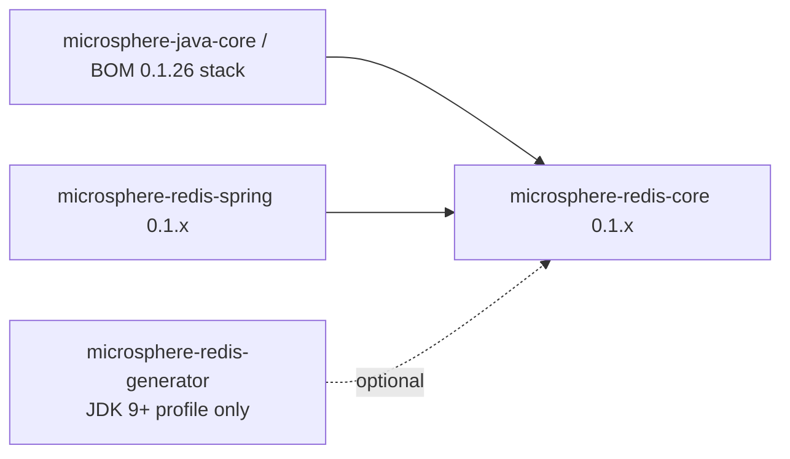

# microsphere-redis-core — Developer Guide (1.x)

| Field | Value |
|-------|-------|
| Module | `microsphere-redis-core` |
| Git branch | `release-1.x` (1.x line, latest release `0.1.14`) |
| Layer | Foundation |
| Baseline | Java 8 (no records, no text blocks) |

> Architecture is the same as the [0.2.x core developer guide](../current/microsphere-redis-core.md).
> This document records the 1.x-specific facts and verified source diffs.

## Module Position

## Verified Differences vs 0.2.x (`git diff origin/release-1.x origin/release -- core`)

| File | 1.x | 0.2.x |
|------|-----|-------|
| `util/RawValue.java` | plain final-field class: private constructor + `RawValue.of(bytes)` factory, `Arrays`/`arrayEquals` based equality | `record RawValue(byte[] data)` |
| `util/ValueHolder.java` | same ThreadLocal cache contract; 2-line diff (no record usage) | identical semantics |
| `metadata/RedisMetadata.java` | same model + `merge`; 3-line diff | identical semantics |
| catalogs | same `META-INF/redis-commands`, `META-INF/redis-write-commands` | same |

`MethodMetadata`, `ParameterMetadata`, `Parameter`, `MethodInfo`, `RedisMetadataLoader`,
`RedisCommandUtils`, `RedisUtils` are unchanged between the branches (no diff entries).

## Design Notes (1.x)

- **Java 8 compatibility is the driver** of the `RawValue` difference: the class existed first; the 0.2.x
  line replaced it with a `record`. Any external code using `RawValue.of(...)` keeps compiling on 1.x only
  (records don't add factories).
- The id grammar (`buildMethodId/Signature/Index`) and the catalog files are shared with the generator and
  the runtime repository exactly as in 0.2.x — that's why the same `index: 498782566` for `pfAdd` appears
  in both lines' YAML.

## Testing Strategy

Same test set as 0.2.x (`RedisMetadataTest`, `ValueHolderTest`, `RedisCommandUtilsTest`,
`RawValueTest`, SPI registration via `TestRedisMetadataLoader`), executed on the Boot 2-era dependency
alignment from `microsphere-spring-cloud-dependencies:0.1.26`.

## Links

- User guide: [../../user-guide/1.x/microsphere-redis-core.md](../../user-guide/1.x/microsphere-redis-core.md)
- Chinese: [../zh/microsphere-redis-core.md](zh/microsphere-redis-core.md)
- Full architecture: [../current/microsphere-redis-core.md](../current/microsphere-redis-core.md)
