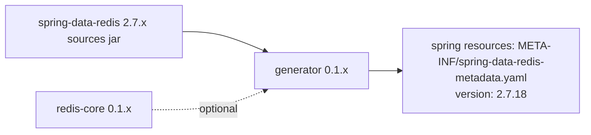

# microsphere-redis-generator — Developer Guide (1.x)

| Field | Value |
|-------|-------|
| Module | `microsphere-redis-generator` |
| Git branch | `release-1.x` (1.x line, latest release `0.1.14`) |
| Layer | Tooling (build-time) |
| Activation | **only under the root pom's `java9+` profile** (`<jdk>[9,)</jdk>`) |

> Architecture is the same as the [0.2.x generator developer guide](../current/microsphere-redis-generator.md).
> This document records 1.x-specific facts.

## Module Position



## 1.x-Specific Build Wiring

The root pom of `release-1.x` lists only seven modules unconditionally; `microsphere-redis-generator` is
added by:

```xml
<profile>
    <id>java9+</id>
    <activation><jdk>[9,)</jdk></activation>
    <modules><module>microsphere-redis-generator</module></modules>
</profile>
```

Reason: the 1.x runtime line compiles for Java 8 (see `RawValue` being a class, not a record), while the
doclet implementation (`ElementScanner9`, `jdk.javadoc.doclet`) requires JDK 9+. On a JDK-8 build the
already-generated YAML simply ships inside `microsphere-redis-spring`'s resources; on JDK 9+ the same
unpack→doclet→validate→emit pipeline as 0.2.x runs.

## Verified Differences vs 0.2.x

| Aspect | 1.x | 0.2.x |
|--------|-----|-------|
| `SpringDataRedisMetadataGenerator` | 1-line diff (import cosmetics) | same flow |
| Parsed sources | `spring-data-redis:2.7.x` (`*Commands.java`) | 3.x |
| YAML header | `version: 2.7.18` | `version: 3.5.10` |
| Method count / commands | SDR 2.x surface (reactive geo/streams commands absent, etc.) | SDR 3.x surface |
| Activation | JDK-profiled | unconditional module |

The doclet classes themselves (`SpringDataRedisMetadataGenerationDoclet`, visitors, validators) show **no
source diff** between the branches — only what they parse differs.

## Design Patterns / Key Flow

Identical to 0.2.x: Visitor (`ElementScanner9` + `DocTreeScanner`), by-name doclet option
`--metadata-file`, index/method/command validation against core catalogs (duplicate index aborts the
build), SnakeYAML emission. See [../current/microsphere-redis-generator.md](../current/microsphere-redis-generator.md).

## Links

- User guide: [../../user-guide/1.x/microsphere-redis-generator.md](../../user-guide/1.x/microsphere-redis-generator.md)
- Chinese: [../zh/microsphere-redis-generator.md](zh/microsphere-redis-generator.md)
