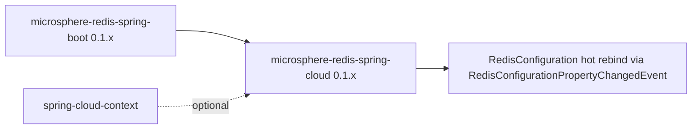

# microsphere-redis-spring-cloud — Developer Guide (1.x)

| Field | Value |
|-------|-------|
| Module | `microsphere-redis-spring-cloud` |
| Git branch | `release-1.x` (1.x line, latest release `0.1.14`) |
| Layer | Spring Cloud hot-refresh bridge |
| Baseline | Spring Boot 2.x, spring-cloud-context 2021/2022-era |

## Module Position

## Verified Source Diffs vs 0.2.x

| File | 1.x | 0.2.x |
|------|-----|-------|
| `autoconfigure/RedisCloudAutoConfiguration.java` | `@AutoConfigureAfter(name = "o.s.b.autoconfigure.data.redis.RedisAutoConfiguration")` — single entry (Boot [2.0, 4.0)) | also lists the relocated `o.s.boot.data.redis.autoconfigure.DataRedisAutoConfiguration` (Boot [4.0,)) |
| `resources/META-INF/config/default/features.yaml` | 7 lines shorter: Boot 3.4 `LettuceClientOptionsBuilderCustomizer`, Boot 3.1 `RedisConnectionDetails` and Boot-4 ordering entries absent | full list |
| `Propagating...Listener` | **no diff** — same prefix filter (`microsphere.redis.`) and republish logic (Listener.java:38–44) | same |

Registration is via the Boot 2.7-compatible `META-INF/spring/...AutoConfiguration.imports` file on **both**
branches (single entry: `RedisCloudAutoConfiguration`).

## Behavior (identical to 0.2.x)

`EnvironmentChangeEvent` → filter keys starting with `microsphere.redis.` →
`RedisConfigurationPropertyChangedEvent` → `RedisConfiguration` rebinds
enabled/command-event-exposed switches at runtime (no restart). See the
[0.2.x cloud developer guide](../current/microsphere-redis-spring-cloud.md) for the sequence diagram and
pattern table.

## 1.x-Specific Notes

- On Boot 2, `/actuator/refresh` is the standard trigger; the module degrades to a no-op when
  spring-cloud-context is absent (class-name condition).

## Links

- User guide: [../../user-guide/1.x/microsphere-redis-spring-cloud.md](../../user-guide/1.x/microsphere-redis-spring-cloud.md)
- Chinese: [../zh/microsphere-redis-spring-cloud.md](zh/microsphere-redis-spring-cloud.md)
