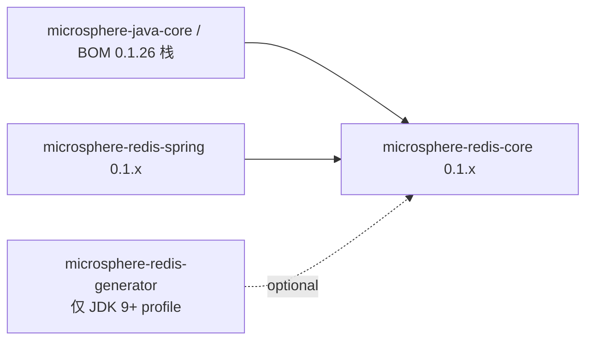

# microsphere-redis-core — 开发者文档（1.x）

| 字段 | 值 |
|------|-----|
| 模块 | `microsphere-redis-core` |
| Git 分支 | `release-1.x`（1.x 版本线，最新发布 `0.1.14`） |
| 层次 | 基础层 |
| 基线 | Java 8（无 record、无 text block） |

> 架构与 [0.2.x core 开发者文档](../../current/zh/microsphere-redis-core.md)相同。
> 本文记录已核实的 1.x 特有事实与源码差异。

## 模块位置

## 已核实的与 0.2.x 差异（`git diff origin/release-1.x origin/release -- core`）

| 文件 | 1.x | 0.2.x |
|------|-----|-------|
| `util/RawValue.java` | 普通 final 字段类：私有构造器 + `RawValue.of(bytes)` 工厂，基于 `Arrays`/`arrayEquals` 的相等性 | `record RawValue(byte[] data)` |
| `util/ValueHolder.java` | 相同 ThreadLocal 缓存契约；2 行差异（不使用 record） | 语义一致 |
| `metadata/RedisMetadata.java` | 相同模型 + `merge`；3 行差异 | 语义一致 |
| 命令目录 | 同样的 `META-INF/redis-commands`、`META-INF/redis-write-commands` | 相同 |

`MethodMetadata`、`ParameterMetadata`、`Parameter`、`MethodInfo`、`RedisMetadataLoader`、
`RedisCommandUtils`、`RedisUtils` 在两个分支之间无差异（diff 中无条目）。

## 设计说明（1.x）

- **Java 8 兼容性**是 `RawValue` 差异的根因：类形态在先，0.2.x 线才改为 `record`。
  使用 `RawValue.of(...)` 的外部代码只能在 1.x 编译（record 不会添加工厂方法）。
- id 语法（`buildMethodId/Signature/Index`）与目录文件和 0.2.x 完全共享 —— 这就是两条线 YAML 中
  `pfAdd` 的 `index: 498782566` 相同的原因。

## 测试策略

与 0.2.x 相同的测试集（`RedisMetadataTest`、`ValueHolderTest`、`RedisCommandUtilsTest`、
`RawValueTest`、经 `TestRedisMetadataLoader` 验证的 SPI 注册），依赖对齐
`microsphere-spring-cloud-dependencies:0.1.26`。

## 链接

- 用户文档：[../../../user-guide/1.x/zh/microsphere-redis-core.md](../../../user-guide/1.x/zh/microsphere-redis-core.md)
- English: [../microsphere-redis-core.md](../microsphere-redis-core.md)
- 完整架构：[../../current/zh/microsphere-redis-core.md](../../current/zh/microsphere-redis-core.md)
