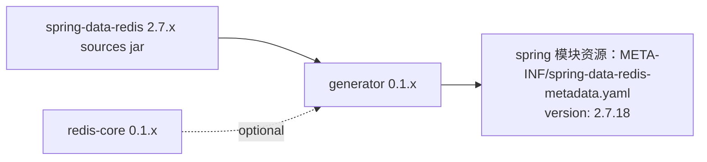

# microsphere-redis-generator — 开发者文档（1.x）

| 字段 | 值 |
|------|-----|
| 模块 | `microsphere-redis-generator` |
| Git 分支 | `release-1.x`（1.x 版本线，最新发布 `0.1.14`） |
| 层次 | 工具（构建期） |
| 激活条件 | **仅在根 pom 的 `java9+` profile**（`<jdk>[9,)</jdk>`）下 |

> 架构与 [0.2.x generator 开发者文档](../../current/zh/microsphere-redis-generator.md)相同。本文记录 1.x 特有事实。

## 模块位置



## 1.x 特有的构建装配

`release-1.x` 根 pom 无条件列出七个模块；`microsphere-redis-generator` 由以下 profile 加入：

```xml
<profile>
    <id>java9+</id>
    <activation><jdk>[9,)</jdk></activation>
    <modules><module>microsphere-redis-generator</module></modules>
</profile>
```

原因：1.x 运行线编译基线为 Java 8（`RawValue` 仍是类而非 record），而 doclet 实现
（`ElementScanner9`、`jdk.javadoc.doclet`）需要 JDK 9+。JDK 8 构建时，已生成的 YAML 直接随
`microsphere-redis-spring` 资源出厂；JDK 9+ 时执行与 0.2.x 相同的解包→doclet→校验→输出管线。

## 已核实的与 0.2.x 差异

| 方面 | 1.x | 0.2.x |
|------|-----|-------|
| `SpringDataRedisMetadataGenerator` | 1 行差异（import 外观） | 流程一致 |
| 解析的源码 | `spring-data-redis:2.7.x`（`*Commands.java`） | 3.x |
| YAML 头部 | `version: 2.7.18` | `version: 3.5.10` |
| 方法/命令集合 | SDR 2.x 接口面（无 3.x 新增响应式 geo/streams 等） | SDR 3.x 接口面 |
| 激活 | JDK profile 控制 | reactor 无条件包含 |

doclet 本体（`SpringDataRedisMetadataGenerationDoclet`、访问器、校验器）在两分支间**无源码差异** ——
变化的只是被解析的内容。

## 设计模式 / 关键流程

与 0.2.x 完全相同：访问者（`ElementScanner9` + `DocTreeScanner`）、doclet 选项 `--metadata-file`、
对照 core 目录的 index/method/command 校验（index 重复即构建失败）、SnakeYAML 输出。
详见 [../../current/zh/microsphere-redis-generator.md](../../current/zh/microsphere-redis-generator.md)。

## 链接

- 用户文档：[../../../user-guide/1.x/zh/microsphere-redis-generator.md](../../../user-guide/1.x/zh/microsphere-redis-generator.md)
- English: [../microsphere-redis-generator.md](../microsphere-redis-generator.md)
