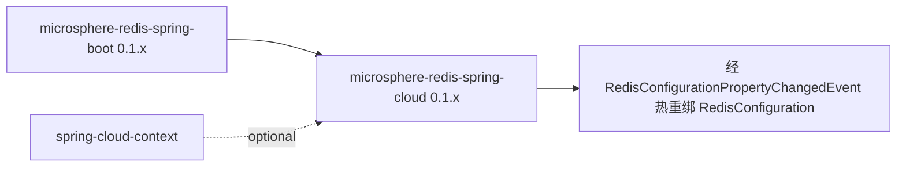

# microsphere-redis-spring-cloud — 开发者文档（1.x）

| 字段 | 值 |
|------|-----|
| 模块 | `microsphere-redis-spring-cloud` |
| Git 分支 | `release-1.x`（1.x 版本线，最新发布 `0.1.14`） |
| 层次 | Spring Cloud 热刷新桥接 |
| 基线 | Spring Boot 2.x、spring-cloud-context 2021/2022 系 |

## 模块位置

## 已核实的源码差异 vs 0.2.x

| 文件 | 1.x | 0.2.x |
|------|-----|-------|
| `autoconfigure/RedisCloudAutoConfiguration.java` | `@AutoConfigureAfter(name = "o.s.b.autoconfigure.data.redis.RedisAutoConfiguration")` —— 单条目（Boot [2.0, 4.0)） | 额外列出搬迁后的 `o.s.boot.data.redis.autoconfigure.DataRedisAutoConfiguration`（Boot [4.0,)） |
| `resources/META-INF/config/default/features.yaml` | 少 7 行：无 Boot 3.4 `LettuceClientOptionsBuilderCustomizer`、Boot 3.1 `RedisConnectionDetails` 及 Boot-4 排序条目 | 完整清单 |
| `Propagating...Listener` | **无差异** —— 同样的前缀过滤（`microsphere.redis.`）与重新发布逻辑（Listener.java:38–44） | 相同 |

两个分支都通过 Boot 2.7 兼容的 `META-INF/spring/...AutoConfiguration.imports` 文件注册
（单条目：`RedisCloudAutoConfiguration`）。

## 行为（与 0.2.x 相同）

`EnvironmentChangeEvent` → 过滤 `microsphere.redis.` 前缀键 →
`RedisConfigurationPropertyChangedEvent` → `RedisConfiguration` 运行期重绑
enabled/command-event-exposed 开关（无需重启）。时序图与模式表见
[0.2.x cloud 开发者文档](../../current/zh/microsphere-redis-spring-cloud.md)。

## 1.x 特有说明

- Boot 2 上标准触发方式即 `/actuator/refresh`；spring-cloud-context 缺失时模块因类名条件退化为无操作。

## 链接

- 用户文档：[../../../user-guide/1.x/zh/microsphere-redis-spring-cloud.md](../../../user-guide/1.x/zh/microsphere-redis-spring-cloud.md)
- English: [../microsphere-redis-spring-cloud.md](../microsphere-redis-spring-cloud.md)
