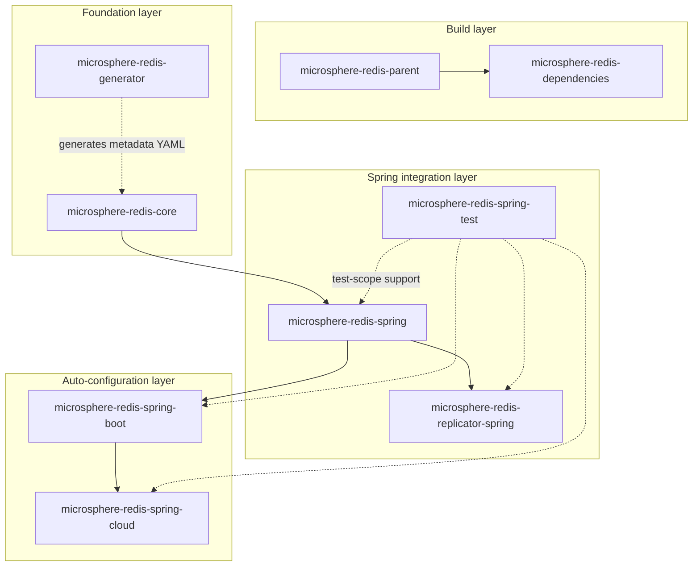

# Developer Guide

English | [中文](./zh/README.md)

The Developer Guide is written for **contributors and maintainers**. Each Maven module has its own document covering:

- **Architecture design** — module layering, package layout and extension points
- **Source analysis** — class-by-class walkthrough of the important implementation internals
- **Design patterns** — SPI, Proxy, Wrapper/Decorator, Template Method, Observer, Registry, Factory…
- **Flowcharts** — Mermaid diagrams for complex flows (interception chain, event publishing, Kafka replication…)
- **Module dependency diagrams** — Mermaid graphs of Maven dependencies between modules

## Choose your release line

| Release line | Docs | Git branch | Version | Spring Data Redis | Typical stack |
|--------------|------|-----------|---------|-------------------|---------------|
| Current      | [`current/`](./current/) | `release`     | 0.2.x (`0.2.14`) | 3.0.0 – 3.5.x | Spring Boot 3.x, Java 17+ |
| Legacy 1.x   | [`1.x/`](./1.x/)         | `release-1.x` | 0.1.x (`0.1.14`) | 2.1.0 – 2.7.x | Spring Boot 2.x, Java 8+ |

## Module documents (current / 0.2.x)

- [microsphere-redis-parent](./current/microsphere-redis-parent.md)
- [microsphere-redis-dependencies](./current/microsphere-redis-dependencies.md)
- [microsphere-redis-core](./current/microsphere-redis-core.md)
- [microsphere-redis-generator](./current/microsphere-redis-generator.md)
- [microsphere-redis-spring](./current/microsphere-redis-spring.md)
- [microsphere-redis-spring-test](./current/microsphere-redis-spring-test.md)
- [microsphere-redis-replicator-spring](./current/microsphere-redis-replicator-spring.md)
- [microsphere-redis-spring-boot](./current/microsphere-redis-spring-boot.md)
- [microsphere-redis-spring-cloud](./current/microsphere-redis-spring-cloud.md)

Chinese translations live in [`current/zh/`](./current/zh/) with identical file names.

## Module documents (1.x / 0.1.x)

The same nine modules are documented under [`1.x/`](./1.x/) (Chinese in [`1.x/zh/`](./1.x/zh/)).

## Overall architecture

See the individual developer-guide documents for a deeper analysis of each edge.
