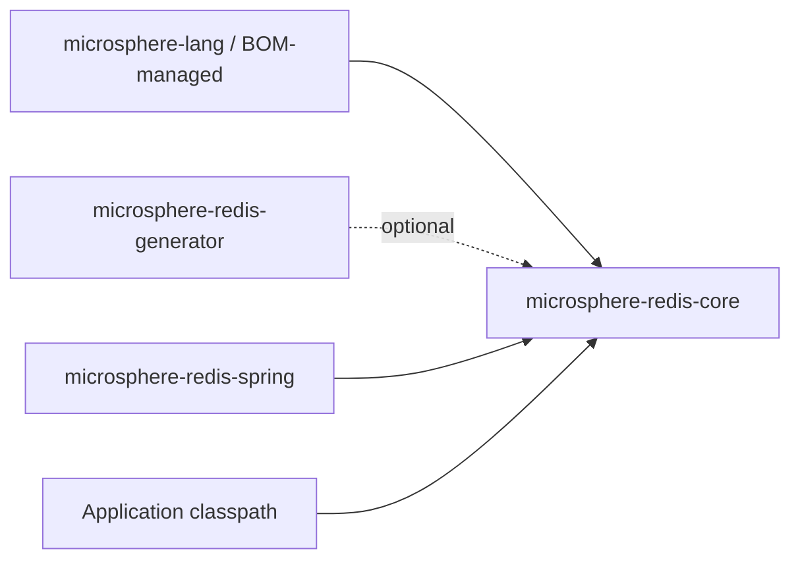
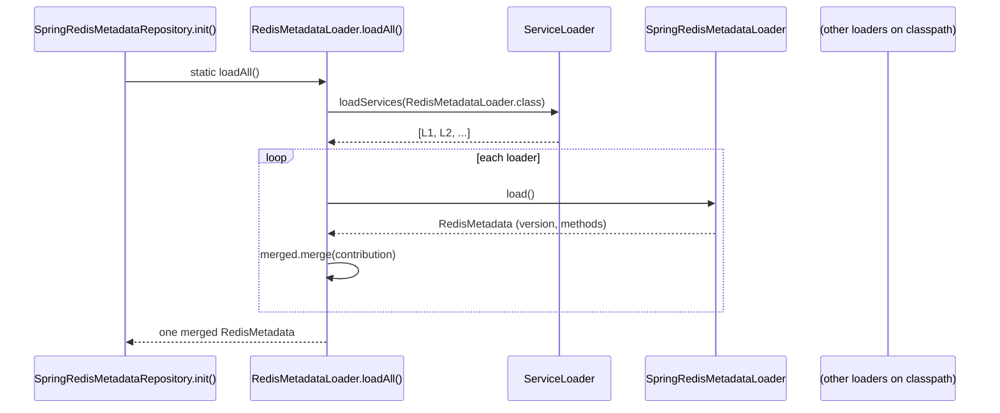

# microsphere-redis-core — Developer Guide

| Field | Value |
|-------|-------|
| Module | `microsphere-redis-core` |
| Git branch | `release` (0.2.x, latest release `0.2.14`) |
| Layer | Foundation |
| Consumers | `microsphere-redis-spring` (compile), `microsphere-redis-generator` (optional) |

## Module Position & Dependencies



The module compiles against `io.microsphere` utilities only (`SymbolConstants`, `ArrayUtils`,
`ServiceLoaderUtils`, `@Nonnull`) — there is **no Spring dependency**, keeping the metadata model reusable by
build-time tooling and runtime integration alike.

## Package Layout

```
io.microsphere.redis.metadata   # command metadata model + loader SPI
io.microsphere.redis.util       # RawValue, ValueHolder, RedisCommandUtils, RedisUtils
resources/META-INF/
    redis-commands              # line-oriented catalog of all Redis commands
    redis-write-commands        # write-command subset
```

## Source Analysis

### metadata package

The model is a **pure data layer** intended for SnakeYAML binding (default constructors + JavaBeans setters):

- `RedisMetadata` — `{version, List<MethodMetadata>}`. `getMethods()` lazily initializes a `LinkedList`;
  `merge(RedisMetadata another)` (RedisMetadata.java:113) adopts the other's `version` (last loader wins) and
  appends its methods — this is what makes `loadAll()` a fold over SPI contributions.
- `MethodMetadata` — seven fields (`index`, `interfaceName`, `methodName`, `parameterNames`, `parameterTypes`,
  `commands`, `write`). The `index` is not arbitrary: it is `RedisCommandUtils.buildMethodIndex(...)` of the
  declaring interface + method name + JVM parameter type names, giving every command method a stable compact id
  usable as a map key on hot paths.
- `MethodInfo` — runtime join of `java.lang.reflect.Method` + `MethodMetadata` + `List<ParameterMetadata>`;
  `id` computed once in the constructor (`buildMethodId(method)`).
- `ParameterMetadata` / `Parameter` — parameter-side twins: metadata (index/type/name, immutable) vs. runtime
  binding (`Parameter` holds the actual `value` plus a mutable `rawValue` byte array).
- `RedisMetadataLoader` — the SPI. `loadAll()` (RedisMetadataLoader.java:68) calls
  `ServiceLoaderUtils.loadServices(RedisMetadataLoader.class)` and merges every contribution.

### util package

- `RawValue` — `record RawValue(byte[] data)`; the identity key for byte-array lookups (record `equals`/`hashCode`
  compare array contents).
- `ValueHolder` — **ThreadLocal singleton** (`holder = withInitial(() -> new ValueHolder(4))`, ValueHolder.java:58)
  over a `Map<Object,Object> cache`. `set(value, rawValue)` stores both directions; `getValue(byte[])` /
  `getRawValue(Object)` query them; `get()` returns the current thread's instance and `clear()` evicts it.
  Contract: it must be cleared when the thread's work ends (the Spring module's serializers and interceptor
  contexts do exactly that), otherwise entries leak across pooled requests.
- `RedisCommandUtils` — an `implements Utils` abstract final-style utility. Static initializer eagerly loads the two
  META-INF catalogs through `RedisUtils.loadResource(...)`. Command checks are plain `Set.contains`; the
  `buildMethodId/Signature/Index` family defines the canonical id grammar shared by the generator and the runtime
  repository (the reason both agree on the same `index` without contacting each other).
- `RedisUtils` — classpath reading abstraction: `loadResource` / `loadResources` accept a
  `ThrowableFunction<InputStream,T>`; `CLASS_LOADER` defaults to the microsphere default class loader. All resource
  parsing in this repo funnels through here (command catalogs, metadata YAML).

## Design Patterns

| Pattern | Where |
|---------|-------|
| **SPI / ServiceLoader** | `RedisMetadataLoader.loadAll()` discovers implementations; the Spring module registers `SpringRedisMetadataLoader` in `META-INF/services` |
| **Composite / Merge** | `RedisMetadata.merge` folds contributions; last-write-wins versioning |
| **Immutable value objects** | `RawValue` record; `ParameterMetadata`; `MethodInfo` (final fields, precomputed id) |
| **Thread-local context** | `ValueHolder` — per-thread object↔bytes cache |
| **Utility class (non-instantiable)** | private constructors in `RedisCommandUtils`, `RedisUtils` |
| **JavaBean/DTO for deserialization** | `RedisMetadata`, `MethodMetadata` setters used by SnakeYAML |

## Key Flows

### Metadata aggregation at startup



### Raw-value round trip (why ValueHolder exists)

```mermaid
flowchart LR
    A[template.opsForValue().set keyObj, valueObj] --> B[RedisSerializer serializes to bytes]
    B --> C[HoldingValueRedisSerializerWrapper records keyObj↔bytes and valueObj↔bytes into ValueHolder.get()]
    C --> D[RedisConnection.set bytes, bytes — intercepted]
    D --> E[Interceptor reads byte args]
    E --> F[ValueHolder.getValue bytes -> original Java object]
```

## Testing Strategy

`src/test/java` covers every class: `RedisMetadataTest`, `MethodMetadataTest`, `ParameterMetadataTest`,
`ParameterTest`, `MethodInfoTest` (POJO contracts incl. `merge`), `RedisMetadataLoaderTest` +
`TestRedisMetadataLoader` (SPI registration via `src/test/resources/META-INF/services/...`), `RawValueTest`,
`ValueHolderTest`, `RedisCommandUtilsTest`, `RedisUtilsTest`.

## Extension Points

- **Contribute metadata**: implement `RedisMetadataLoader`, register under `META-INF/services`.
- **Extend command catalogs**: the catalogs are classpath resources read by `RedisUtils.loadResource`; the sibling
  `loadResources` helper (all matches of a resource name) is available for tools that need the multi-resource view.
- **Reuse the id grammar**: any external tool that must agree with runtime method indexes should call
  `RedisCommandUtils.buildMethodIndex` rather than hashing independently.

## Links

- User guide: [../../user-guide/current/microsphere-redis-core.md](../../user-guide/current/microsphere-redis-core.md)
- [Generator developer guide](./microsphere-redis-generator.md) — the build-time producer of this module's YAML contract
- [Spring developer guide](./microsphere-redis-spring.md) — the runtime consumer
