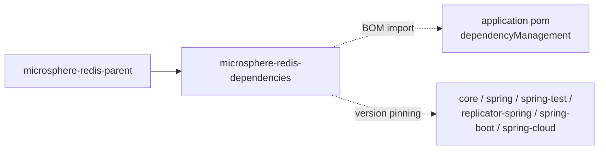

# microsphere-redis-dependencies — Developer Guide

| Field | Value |
|-------|-------|
| Module | `microsphere-redis-dependencies` |
| Git branch | `release` (0.2.x, latest release `0.2.14`) |
| Layer | Build: BOM (pom packaging, `dependencyManagement` only) |
| Consumed by | applications and libraries that import it as a BOM |

## Module Position



## Source Analysis (pom only)

`microsphere-redis-dependencies/pom.xml` manages exactly the **six consumable jar modules**, all at
`${revision}` (microsphere-redis-dependencies/pom.xml:24–58):

| artifactId | line |
|------------|------|
| `microsphere-redis-core` | :26 |
| `microsphere-redis-spring` | :32 |
| `microsphere-redis-spring-test` | :38 |
| `microsphere-redis-replicator-spring` | :44 |
| `microsphere-redis-spring-boot` | :50 |
| `microsphere-redis-spring-cloud` | :56 |

`microsphere-redis-generator` is intentionally **absent**: it is build-time tooling (exec-maven-plugin
driven), not a runtime dependency, so it must not appear in an application BOM.

Because the parent is `microsphere-redis-parent`, importing this BOM in an application transitively
aligns with the same Spring Data Redis / Spring Boot versions the modules were compiled against.

## Build System Notes

- The flatten plugin resolves `${revision}` at publish time, so consumers see concrete versions (e.g. `0.2.14`).
- BOM-only artifacts never add dependencies; they only pin versions. Consumers still choose which module(s) to depend on.

## Extension Points

- Typical usage (Spring Boot app):

```xml
<dependencyManagement>
    <dependencies>
        <dependency>
            <groupId>io.microsphere</groupId>
            <artifactId>microsphere-redis-dependencies</artifactId>
            <version>0.2.14</version>
            <type>pom</type>
            <scope>import</scope>
        </dependency>
    </dependencies>
</dependencyManagement>
```

after which `<dependency>` entries for any of the six modules omit `<version>`.

## Links

- User guide: [../../user-guide/current/microsphere-redis-dependencies.md](../../user-guide/current/microsphere-redis-dependencies.md)
- Chinese: [../zh/microsphere-redis-dependencies.md](zh/microsphere-redis-dependencies.md)
- Previous: [microsphere-redis-parent](./microsphere-redis-parent.md) · Back to index: [README](../README.md)
