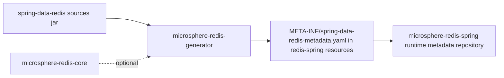
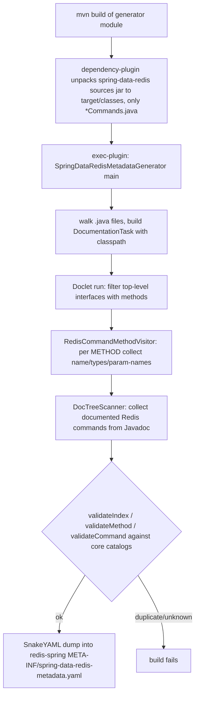

# microsphere-redis-generator — Developer Guide

| Field | Value |
|-------|-------|
| Module | `microsphere-redis-generator` |
| Git branch | `release` (0.2.x, latest release `0.2.14`) |
| Layer | Tooling (build-time) |
| Consumers | none at runtime — invoked by `exec-maven-plugin` during the build |

## Purpose

Produce `microsphere-redis-spring/src/main/resources/META-INF/spring-data-redis-metadata.yaml` — the mapping of every
top-level `Redis*Commands` interface method of Spring Data Redis to Redis server commands — by parsing the
**sources jar** of `spring-data-redis` with the JDK documentation tool and a custom `Doclet`.

## Module Dependencies



All dependencies are `optional` (`microsphere-redis-core`, `spring-data-redis`, `reactor-core`, `snakeyaml`,
`microsphere-lang-model`, `microsphere-annotation-processor`): the module is a build-time tool, never a runtime node.

## Build Wiring (pom)

Two plugins cooperate — this is the whole "API" of the module:

1. **maven-dependency-plugin** (`src-dependencies` execution, phase `generate-resources`): unpacks
   `org.springframework.data:spring-data-redis:*:sources.jar`, including only
   `org/springframework/data/redis/connection/*Commands.java`, into `${sourcePath}`
   (default `${project.build.directory}/classes`).
2. **exec-maven-plugin** (`exec` goal): runs
   `java -classpath <module classpath> --add-opens=java.base/java.lang.invoke=ALL-UNNAMED
   io.microsphere.redis.generator.metadata.SpringDataRedisMetadataGenerator ${sourcePath} <target yaml>`.

So generation happens whenever the module builds: sources are unpacked, then the generator walks them.

## Source Analysis

### SpringDataRedisMetadataGenerator

`main(String[] args)` (SpringDataRedisMetadataGenerator.java:67):

1. Validates args `<source-path> <target-file-path>`.
2. `walkFileTree` collects every `.java` file under the source path.
3. Builds a `DocumentationTool` (`javax.tools.ToolProvider.getSystemDocumentationTool()`) with the current JVM
   class path set as `CLASS_PATH` location, so the doclet can resolve types and load classes.
4. Launches a `DocumentationTask` bound to `SpringDataRedisMetadataGenerationDoclet.class` with the single option
   `--metadata-file=<target>`.
5. Static initializer pins the default `Locale` to `ENGLISH` (deterministic message parsing).

### SpringDataRedisMetadataGenerationDoclet

Implements the modern `jdk.javadoc.doclet.Doclet` interface:

| Element | Role |
|---------|------|
| `METADATA_FILE_OPTION_NAME = "--metadata-file"` | supported option (`StandardOption`, 1 argument) whose `process` captures the output path |
| `getSupportedSourceVersion()` | latest JDK source version |
| `run(DocletEnvironment)` | delegates to `generateSpringDataRedisMetadata` |
| `generateSpringDataRedisMetadata` (line 227) | keeps only top-level interfaces with declared methods, feeds each to `RedisCommandMethodVisitor`; afterwards runs `validateIndex` + `validateMethod` and writes YAML |
| `getSpringDataRedisVersion()` | `RedisCommands.class.getPackage().getImplementationVersion()` — becomes the YAML `version:` (e.g. `3.5.10`) |
| `RedisCommandMethodVisitor extends ElementScanner9` | visits METHOD elements of `Redis*Commands` interfaces; extracts method name, normalized parameter class names (`normalizeClassName` strips generics while preserving arity markers like `[]`), parameter names from Javadoc, and command associations |
| `RedisCommandMethodDocumentVisitor extends DocTreeScanner` | parses Javadoc comment trees to harvest the Redis command names each method documents |
| `deduceMethodParameterClass` | for type-variable parameters, re-parses the source (`javac` Tree API `TreeScanner.visitMethod`) to find the type parameter's first bound, defaulting `java.lang.` for unqualified bounds, then class-loads it |
| `validateCommand / validateIndex / validateMethod` | cross-checks harvested commands against the core catalogs (`RedisCommandUtils.getRedisCommands()/getRedisWriteCommands()`) — the log lines compare "all Redis commands" vs "supported by Spring Data Redis"; duplicate indexes/method ids abort the build |
| `writeSpringDataRedisMetadata` | SnakeYAML dump of `{version, methods: [...]}` with keys `index, interfaceName, methodName, parameterNames, parameterTypes, commands, write` |
| `ReporterLoggerAdapter extends AbstractLogger` | adapts microsphere logging onto the doclet `Reporter` (error/warn → `Diagnostic.Kind`) |

### YAML output contract

The generated file loads directly into core's `RedisMetadata` (see
[core developer guide](./microsphere-redis-core.md)):

```yaml
version: 3.5.10
methods:
- index: 498782566
  interfaceName: org.springframework.data.redis.connection.RedisHyperLogLogCommands
  methodName: pfAdd
  parameterNames: [key, values]
  parameterTypes: ['[B', '[[B']
  commands: [PFADD]
  write: true
```

`index` equals `RedisCommandUtils.buildMethodIndex(interfaceName, methodName, parameterTypes)` — that equality is the
join key used by `SpringRedisMetadataRepository` at runtime.

## Design Patterns

| Pattern | Where |
|---------|-------|
| **Visitor (double dispatch)** | `ElementScanner9` + `DocTreeScanner` over javac element/doc trees; nested `TreeScanner` for source re-parse |
| **Strategy / plugin** | the doclet is injected into `DocumentationTool.getTask(...)` as the behavior of the task |
| **Adapter** | `ReporterLoggerAdapter` bridges `Reporter` ↔ microsphere `Logger` |
| **Template Method** | `StandardOption implements Option` fixes `getKind()`/defaults, subclasses pass name/arg count/process |
| **Pipeline** | unpack sources → doclet parse → validate → YAML emit |

## Generation Flow



## Testing Strategy

The module has no unit tests of the visitors; its test fixture is the checked-in
`src/test/resources/spring-data-redis-metadata.yaml` (format witness), and correctness is enforced at generation
time by the validators plus the `RedisMetadataRepositoryTest` / `SpringRedisMetadataLoaderTest` assertions in the
spring module, which load the real generated file.

## Maintenance Notes

- Upgrading Spring Data Redis regenerates the YAML (the `version:` header changes); command-name drift surfaces as
  `validateCommand` failures.
- The `--add-opens=java.base/java.lang.invoke=ALL-UNNAMED` JVM flag is required because javac internals are used on
  JDK 17.
- On the 0.1.x branch this module is only activated under a JDK 9+ profile (see
  [../../1.x/microsphere-redis-generator.md](../1.x/microsphere-redis-generator.md)).

## Links

- User guide: [../../user-guide/current/microsphere-redis-generator.md](../../user-guide/current/microsphere-redis-generator.md)
- [Core developer guide](./microsphere-redis-core.md) — catalog + id grammar the doclet validates against
