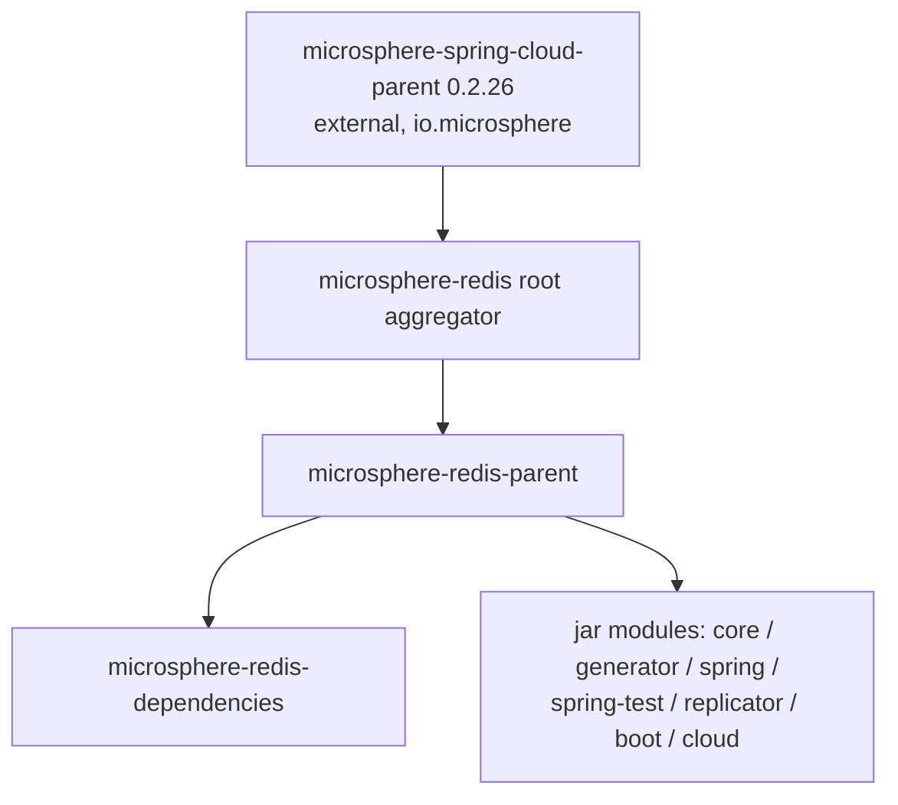

# microsphere-redis-parent — Developer Guide

| Field | Value |
|-------|-------|
| Module | `microsphere-redis-parent` |
| Git branch | `release` (0.2.x, latest release `0.2.14`) |
| Layer | Build: dependency-management parent (pom packaging) |
| Consumed by | every jar module's effective parent chain |

## Module Position

Note the two roles the root reactor plays: `pom.xml` at the repository root is the **aggregator**
(declares all 8 modules, sets `revision=0.2.15-SNAPSHOT`, `java.version=17`, pom.xml:55–56) while
`microsphere-redis-parent` is the **inheritance parent** jar modules extend.

## Source Analysis (pom only)

- `microsphere-redis-parent/pom.xml` declares `<parent>microsphere-redis</parent>` and imports the
  `microsphere-spring-cloud-dependencies:0.2.26` BOM (microsphere-redis-parent/pom.xml:31–34, property
  `microsphere-spring-cloud.version`, line 23). That single import brings consistent versions for
  Spring Framework, Spring Boot, Spring Data Redis, Jackson, logging, and the whole `io.microsphere`
  utility stack — **no version tag appears in any jar module pom**.
- Version propagation uses the `${revision}` + flatten-maven-plugin convention: modules publish real
  resolved versions even though the reactor sources all say `${revision}`.
- Java baseline: `17` (inherited from the root property), which is what enables `record` usage in core
  (`RawValue`) and the `ElementScanner9`-based generator on modern JDKs.

## Build System Notes

- Release flow (visible in git history): work merges `main → release`, the release pipeline publishes,
  then version bumps return — hence `release` == latest published line and the tip here is
  `0.2.15-SNAPSHOT` with `0.2.14` published.
- CI composes Redis/Kafka via the repo's `docker/` files and the shared `setup-compose` GitHub action
  (current: v2.3.0) before integration tests run.

## Extension Points

- To consume: `microsphere-redis-parent` as your `<parent>` if you want the full managed stack, or import
  `microsphere-redis-dependencies` (see [next](./microsphere-redis-dependencies.md)) inside `dependencyManagement`.

## Links

- User guide: [../../user-guide/current/microsphere-redis-parent.md](../../user-guide/current/microsphere-redis-parent.md)
- Chinese: [../zh/microsphere-redis-parent.md](zh/microsphere-redis-parent.md)
- Previous: [microsphere-redis-spring-cloud](./microsphere-redis-spring-cloud.md) · Next: [microsphere-redis-dependencies](./microsphere-redis-dependencies.md)
