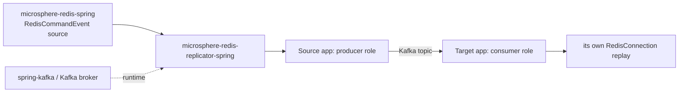
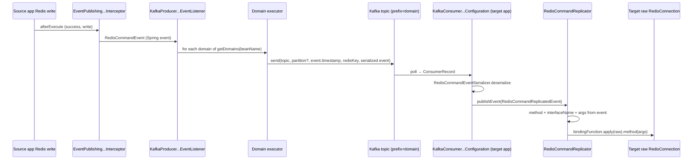

# microsphere-redis-replicator-spring — Developer Guide

| Field | Value |
|-------|-------|
| Module | `microsphere-redis-replicator-spring` |
| Git branch | `release` (0.2.x, latest release `0.2.14`) |
| Layer | Optional add-on: Redis write-command replication over Kafka |
| Dependencies | `microsphere-redis-spring` (compile), `spring-kafka` (optional) |

## Module Position & Dependencies



The replicator consumes `RedisCommandEvent`s published by the spring module's
`EventPublishingRedisCommandInterceptor` and replays them against another application's Redis —
"write-command replication without Redis replication".

## Package Layout

```
io.microsphere.redis.replicator.spring
    RedisCommandReplicator.java          # replay engine (consumer side)
    RedisReplicatorInitializer.java      # RedisModuleInitializer bridge (spring.factories)
    RedisReplicatorModuleInitializer.java# replicator-level SPI (supports producer/consumer roles)
    config/RedisReplicatorConfiguration  # property model + hot reload
    event/RedisCommandReplicatedEvent    # wrapped RedisCommandEvent + domain + record metadata
    kafka/
        KafkaRedisReplicatorConfiguration.java        # shared base (bootstrap servers, topic prefix)
        KafkaRedisReplicatorModuleInitializer.java    # registers producer + consumer configs
        producer/KafkaProducerRedisReplicatorConfiguration.java
        producer/KafkaProducerRedisCommandEventListener.java
        producer/RedisComandEventPartitioner.java     # SPI: choose partition per event
        consumer/KafkaConsumerRedisReplicatorConfiguration.java
```

## Source Analysis

### Bootstrap chain

`RedisReplicatorInitializer` is registered under the **spring module's own SPI key** in
`META-INF/spring.factories`:

```properties
io.microsphere.redis.spring.context.RedisModuleInitializer=\
io.microsphere.redis.replicator.spring.RedisReplicatorInitializer

io.microsphere.redis.replicator.spring.RedisReplicatorModuleInitializer=\
io.microsphere.redis.replicator.spring.kafka.KafkaRedisReplicatorModuleInitializer
```

So `RedisInitializer` → `RedisReplicatorInitializer` (checks `microsphere.redis.replicator.enabled`) →
loads `RedisReplicatorModuleInitializer` implementations → `KafkaRedisReplicatorModuleInitializer`
registers the producer and consumer `@Configuration`s conditionally
(producer needs `spring-kafka` on the classpath; consumer additionally requires
`microsphere.redis.replicator.consumer.enabled=true`, default **false** — replication is
producer-side-only until a target app opts in).

### config/RedisReplicatorConfiguration (RedisReplicatorConfiguration.java:55)

Property model with hot reload (listens to `RedisConfigurationPropertyChangedEvent`, line 145):

| Property | Default | Meaning |
|----------|---------|---------|
| `microsphere.redis.replicator.enabled` | `true` | master switch (also gated by `microsphere.redis.enabled`) |
| `microsphere.redis.replicator.consumer.enabled` | `false` | start the consumer replay role |
| `microsphere.redis.replicator.domains` | `default` | list of replication domains (line 178) |
| `microsphere.redis.replicator.domains.{domain}.redis-templates` | *empty* | which template bean names belong to a domain (line 196) |
| `...kafka.bootstrap.servers` | `${spring.kafka.bootstrap-servers:127.0.0.1:9092}` | fallback chain in `KafkaRedisReplicatorConfiguration` |
| `...kafka.topic-prefix` | `redis-replicator-event-topic-` | one topic **per domain**: prefix + domain |
| `...kafka.listener.poll-timeout` | `10000` (ms) | consumer poll loop (KafkaConsumerRedisReplicatorConfiguration.java:79) |
| `...kafka.listener.concurrency` | `1` | effective value = `max(topic count, configured)` |

`getDomains(sourceBeanName)` maps an event back to every domain whose template list contains the
event's source bean name — one event can fan out to several domains.

### Producer side

`KafkaProducerRedisCommandEventListener` (KafkaProducerRedisCommandEventListener.java:35) implements
`ApplicationListener<RedisCommandEvent>`:

- `afterSingletonsInstantiated()` (line 138) resolves the replicator config, the dedicated
  `KafkaTemplate<byte[], byte[]>` (raw byte serializers — event bytes come from
  `RedisCommandEventSerializer`), an **optional** `RedisComandEventPartitioner` bean, and builds a
  fixed thread pool sized to the number of domains (line 74).
- `onRedisCommandEvent` (line 80): for each domain of `event.getSourceBeanName()`, submit
  `sendRedisReplicatorKafkaMessage(domain, event)` — sending never blocks the Redis call thread.
- `sendRedisReplicatorKafkaMessage` (line 88): `topic = prefix + domain`;
  `key = generateKafkaKey(event)` (line 115 — the Redis *key*: arg 0 for normal commands, arg 1's
  first `byte[]` for `RedisCommands.execute`); `value = serialize(event)`; partition from the
  partitioner or `null` (Kafka's own key hashing); **timestamp = `event.getTimestamp()`** so replay
  order follows original execution order within a partition.
- `onComplete` (line 101) logs send success/failure — failures are logged, not rethrown.

`RedisComandEventPartitioner` (`Integer partition(RedisCommandEvent)`) is the ordering SPI: return a
partition so that commands touching the same Redis key/keyspace serialize through one Kafka partition.

### Consumer side

`KafkaConsumerRedisReplicatorConfiguration` (consumer, line 47) extends the shared base and wires a
listener container (its `@Bean`, line 118) with group id prefixed `Redis-Replicator-`. For each
`ConsumerRecord<byte[], byte[]>` (line 139):
`consumeRecord` (line 145) deserializes via `RedisCommandEventSerializer`, wraps it as
`RedisCommandReplicatedEvent(sourceEvent, domain)` (line 159) and **publishes it as an application
event** (line 152) — replay is decoupled from transport.

### Replay engine

`RedisCommandReplicator` (RedisCommandReplicator.java:26), bean `microsphere:redisCommandReplicator`:

```java
Method method = redisCommandEvent.getMethod();                       // :49
String interfaceNme = redisCommandEvent.getInterfaceName();          // :50
RedisConnection redisConnection = getRedisConnection();              // :60 → RAW connection, see below
Function<RedisConnection,Object> bindingFunction =
        getRedisCommandBindingFunction(interfaceNme);                // :53 keyCommands() etc.
Object redisCommandObject = bindingFunction.apply(redisConnection);  // :54
invokeMethod(method, redisCommandObject, args);                      // :57
```

Two subtleties:
1. `getRedisConnection()` calls `getRawRedisConnection(...)` (line 62) to **unwrap this app's own
   proxy**, otherwise the replay would re-publish a `RedisCommandEvent` and loop infinitely.
2. The command object is resolved via the metadata repository's interface→binding functions, so replay
   targets the same `Redis*Commands` sub-interface the source app used; the `method`+`args` pair travels
   by reflection, and `trySetAccessible` (line 56) handles non-public interface defaults.

## Design Patterns

| Pattern | Where | Notes |
|---------|-------|-------|
| Observer / Event-driven | listener ← `RedisCommandEvent`; `RedisCommandReplicatedEvent` → `RedisCommandReplicator` | two event hops decouple capture, transport, replay |
| SPI layering | `RedisModuleInitializer` → `RedisReplicatorModuleInitializer` | module auto-boot without explicit `@Enable` |
| Strategy | `RedisComandEventPartitioner` (optional bean) | user-controlled ordering policy |
| Fan-out executor | fixed pool per domain (line 74, 83–85) | domain isolation on the producer |
| Key-based partitioning | `generateKafkaKey` | same Redis key → same partition → ordered log |
| Unwrapping/Delegation | `getRawRedisConnection` in replay | prevents interception recursion |

## Key Flow



## Testing Strategy

- Producer/consumer configuration tests run with `microsphere.redis.replicator.*` properties bound to a
  `MockEnvironment`; replay logic is testable against the metadata repository without Kafka by feeding
  `RedisCommandReplicatedEvent` instances directly.
- End-to-end replication requires Redis + Kafka (`docker/` compose: redis, kafka) with one app started as
  producer and a second JVM with `consumer.enabled=true`.

## Extension Points

- Provide a `RedisComandEventPartitioner` bean to control ordering granularity.
- Implement `RedisReplicatorModuleInitializer` (spring.factories under that key) for non-Kafka transports.
- Listen to `RedisCommandReplicatedEvent` yourself to audit or veto replay before `RedisCommandReplicator` acts.

## Links

- User guide: [../../user-guide/current/microsphere-redis-replicator-spring.md](../../user-guide/current/microsphere-redis-replicator-spring.md)
- Chinese: [../zh/microsphere-redis-replicator-spring.md](zh/microsphere-redis-replicator-spring.md)
- Previous: [microsphere-redis-spring-test](./microsphere-redis-spring-test.md) · Next: [microsphere-redis-spring-boot](./microsphere-redis-spring-boot.md)
