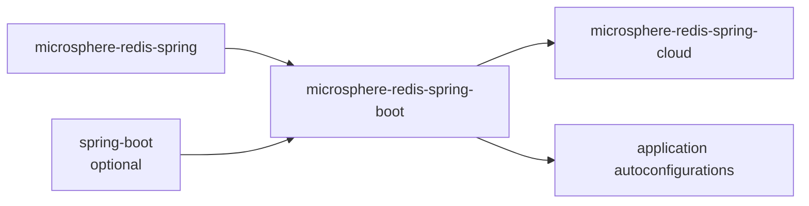
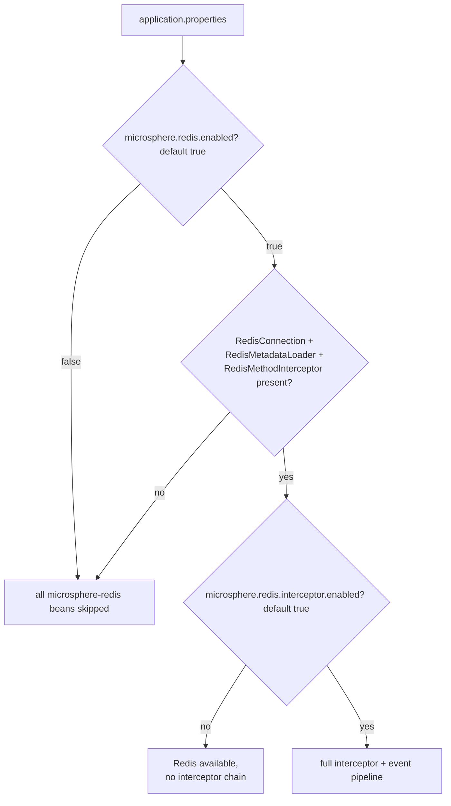

# microsphere-redis-spring-boot — Developer Guide

| Field | Value |
|-------|-------|
| Module | `microsphere-redis-spring-boot` |
| Git branch | `release` (0.2.x, latest release `0.2.14`) |
| Layer | Spring Boot adaptation (conditions only) |
| Dependencies | `microsphere-redis-spring`, `spring-boot-starter` (optional), `spring-boot-actuator` (optional) |

## Module Position & Dependencies



The module deliberately contains **no auto-configuration of its own**: the interceptor wires through
`RedisInitializer` + `RedisInterceptorModuleInitializer` (spring.factories) in the spring module, which
already works in Boot. What Boot adds is a reusable vocabulary of `@Conditional` annotations.

## Package Layout

```
io.microsphere.redis.spring.boot.autoconfigure.condition
    ConditionalOnRedisEnabled.java
    ConditionalOnRedisInterceptorEnabled.java
    ConditionalOnRedisAvailable.java
```

## Source Analysis

- `@ConditionalOnRedisEnabled` (ConditionalOnRedisEnabled.java:73):
  `@ConditionalOnProperty(name = "microsphere.redis.enabled", matchIfMissing = true)` — enabled unless
  explicitly turned off.
- `@ConditionalOnRedisInterceptorEnabled` (ConditionalOnRedisInterceptorEnabled.java:72–73): meta-annotated
  `@ConditionalOnRedisEnabled` **plus** `@ConditionalOnProperty("microsphere.redis.interceptor.enabled",
  matchIfMissing = true)` — two-level gate: Redis overall, then interception.
- `@ConditionalOnRedisAvailable` (ConditionalOnRedisAvailable.java:57–58): `@ConditionalOnRedisEnabled` +
  `@ConditionalOnClass(name = {RedisConnection, RedisMetadataLoader, RedisMethodInterceptor})` — i.e.
  spring-data-redis **and** microsphere-redis-spring must both be on the classpath. `@Target(TYPE)` so it
  guards whole configuration classes.

The three class-name checks in `ConditionalOnRedisAvailable` are by-name strings, so the module loads even
when those classes are absent (Boot evaluates them before class linkage).

## Design Patterns

| Pattern | Where | Notes |
|---------|-------|-------|
| Composable Conditions (meta-annotation) | the three annotations build on each other | Available ⊃ Enabled; InterceptorEnabled ⊃ Enabled |
| Classpath feature detection | `@ConditionalOnClass(name=...)` | no `NoClassDefFoundError` during evaluation |

## Key Flow



## Testing Strategy

Condition annotations are validated indirectly wherever downstream autoconfigurations use them (cloud
module tests, application-level `@ConditionalOnRedisAvailable` classes). There is no behavior to unit-test
beyond annotation metadata.

## Extension Points

- Annotate your own `@Configuration`/`@Bean` with any of the three conditions to stay consistent with the
  framework's enablement model.

## Links

- User guide: [../../user-guide/current/microsphere-redis-spring-boot.md](../../user-guide/current/microsphere-redis-spring-boot.md)
- Chinese: [../zh/microsphere-redis-spring-boot.md](zh/microsphere-redis-spring-boot.md)
- Previous: [microsphere-redis-replicator-spring](./microsphere-redis-replicator-spring.md) · Next: [microsphere-redis-spring-cloud](./microsphere-redis-spring-cloud.md)
