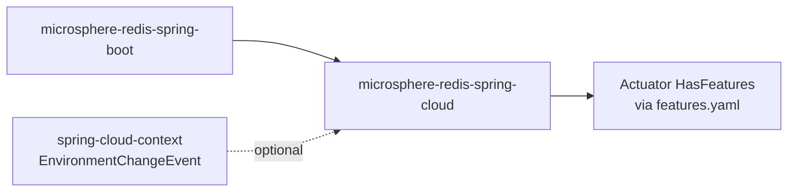
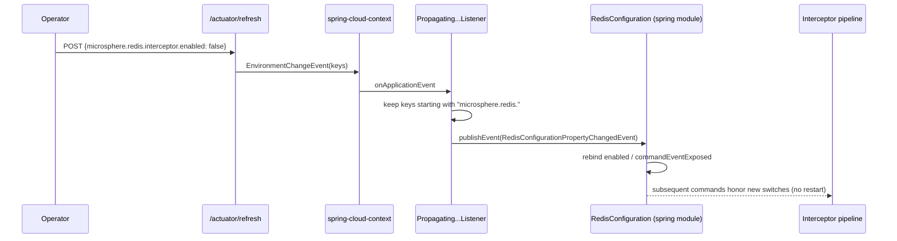

# microsphere-redis-spring-cloud — Developer Guide

| Field | Value |
|-------|-------|
| Module | `microsphere-redis-spring-cloud` |
| Git branch | `release` (0.2.x, latest release `0.2.14`) |
| Layer | Spring Cloud adaptation (runtime property refresh + feature exposure) |
| Dependencies | `microsphere-redis-spring-boot`, `spring-cloud-commons` (optional), `spring-cloud-context` (optional) |

## Module Position & Dependencies



## Package Layout

```
io.microsphere.redis.spring.cloud
    autoconfigure/RedisCloudAutoConfiguration.java
    event/PropagatingRedisConfigurationPropertyChangedEventApplicationListener.java
resources/META-INF/
    spring/org.springframework.boot.autoconfigure.AutoConfiguration.imports
    config/default/features.yaml
```

## Source Analysis

### RedisCloudAutoConfiguration (RedisCloudAutoConfiguration.java:45)

Registered through the Boot 3 `AutoConfiguration.imports` file (single entry). Its annotation stack:

- `@ConditionalOnRedisAvailable` (line 45) — inherits the enabled + classpath gate from the boot module;
- `@ConditionalOnClass(name = "org.springframework.cloud.context.environment.EnvironmentChangeEvent")`
  (line 46) — the whole module switches off when spring-cloud-context is absent;
- `@AutoConfigureAfter(name = {...})` (line 49) — ordered **after** Boot's Redis auto-configuration,
  covering both coordinate eras by name (the class *moved* between Boot versions, so string names are used):
  `o.s.b.autoconfigure.data.redis.RedisAutoConfiguration` (Boot [2.0, 4.0)) and
  `o.s.boot.data.redis.autoconfigure.DataRedisAutoConfiguration` (Boot [4.0,));
- `@Import(PropagatingRedisConfigurationPropertyChangedEventApplicationListener.class)` (line 53).

### Propagating...ApplicationListener (…Listener.java:23)

`ApplicationListener<EnvironmentChangeEvent>`: on a cloud `/actuator/refresh` (or any
`EnvironmentChangeEvent`), it filters the changed keys to those starting with
`microsphere.redis.` (`filterSet(event.getKeys(), this::isRedisPropertyName)`, line 39) and republishes
them as a `RedisConfigurationPropertyChangedEvent` scoped to the application context (line 40).
`RedisConfiguration` (spring module) listens to that event and re-binds
enabled/command-event-exposed switches — so **interception can be toggled at runtime without restart**.
Because the prefix also matches `microsphere.redis.replicator.*`, replicator properties ride the same channel.

### features.yaml (META-INF/config/default/features.yaml)

Declarative input for the microsphere-spring-cloud "HasFeatures" actuator extension: it names the
abstract API surface (RedisTemplate variants, connection factories, cache managers, Boot customizers
per Boot version — including 3.1 `RedisConnectionDetails` and 3.4 `LettuceClientOptionsBuilderCustomizer`)
and maps simple feature names to concrete microsphere classes (all serializers, interceptors,
`DynamicRedisConnectionFactory`, the three conditions, `SpringRedisMetadataLoader`).

## Design Patterns

| Pattern | Where | Notes |
|---------|-------|-------|
| Adapter/Propagator | listener: `EnvironmentChangeEvent` → `RedisConfigurationPropertyChangedEvent` | translates cloud vocabulary into framework vocabulary |
| By-name conditions | `@ConditionalOnClass(name=...)`, `@AutoConfigureAfter(name=...)` | survives class relocations across Boot major versions |
| Declarative feature registry | features.yaml | actuator introspection without code |

## Key Flow



## Testing Strategy

- The listener can be unit-tested by publishing an `EnvironmentChangeEvent` with mixed keys and asserting
  the published `RedisConfigurationPropertyChangedEvent` contains only `microsphere.redis.*`.
- Auto-configuration ordering is exercised by context-startup tests with/without spring-cloud-context on
  the classpath.

## Extension Points

- Any property under `microsphere.redis.` participates in hot refresh automatically (prefix rule).
- Extend features.yaml (or your own module's) to surface new components in actuator output.

## Links

- User guide: [../../user-guide/current/microsphere-redis-spring-cloud.md](../../user-guide/current/microsphere-redis-spring-cloud.md)
- Chinese: [../zh/microsphere-redis-spring-cloud.md](zh/microsphere-redis-spring-cloud.md)
- Previous: [microsphere-redis-spring-boot](./microsphere-redis-spring-boot.md) · Next: [microsphere-redis-parent](./microsphere-redis-parent.md)
