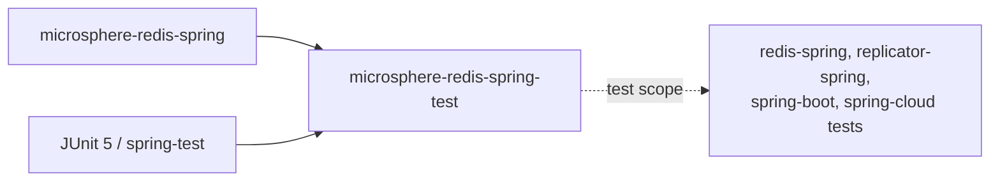

# microsphere-redis-spring-test — Developer Guide

| Field | Value |
|-------|-------|
| Module | `microsphere-redis-spring-test` |
| Git branch | `release` (0.2.x, latest release `0.2.14`) |
| Layer | Test-support library (published, consumed in `test` scope) |
| Dependencies | `microsphere-redis-spring`, JUnit 5, spring-test, spring-data-redis + Lettuce |

## Module Position & Dependencies



The module exists so every downstream module's integration tests share one Redis wiring instead of
duplicating configuration. It is a *published* artifact, not a private test-jar.

## Package Layout

```
io.microsphere.redis.spring.test
    AbstractRedisTest.java        # disabled-by-default base class + canonical SET fixtures
    config/RedisConfig.java       # RedisTemplate / StringRedisTemplate / Lettuce factory beans
```

## Source Analysis

### `AbstractRedisTest` (AbstractRedisTest.java:45)

- Annotated `@Disabled` (line 43) — the base class itself never runs in CI; concrete subclasses (e.g.
  `RedisTest`) override the disablement when a live Redis is available.
- `@SpringJUnitConfig(classes = RedisConfig.class)` (line 44) loads a minimal context with no
  application-server involvement.
- Canonical write-command fixtures (lines 47–51):
  - `SET_METHOD` = `findMethod(RedisConnection.class, "set", byte[].class, byte[].class)` — the exact
    `Method` object interceptor tests compare against metadata;
  - `SET_METHOD_ARGS` = `["key".bytes, "value".bytes]`;
  - `SOURCE_BEAN_NAME_FOR_REDIS_TEMPLATE` = `"redisTemplate"`.
- `assertSet(redisTemplate, key, value)` (line 72) performs `opsForValue().set` then asserts the read-back —
  used by subclass tests to verify interception did not break normal semantics.

### `RedisConfig` (config/RedisConfig.java)

Three `static @Bean` methods (static so they can be registered without instantiating the config class early):
- `redisTemplate(...)` / `stringRedisTemplate(...)` — raw-type Spring templates bound to the factory;
- `redisConnectionFactory()` — `LettuceConnectionFactory("127.0.0.1", 6379)` with explicit
  `afterPropertiesSet()` + `validateConnection()`, i.e. the context **fails fast when Redis is not running**.

## Design Patterns

| Pattern | Where | Notes |
|---------|-------|-------|
| Template Method (test) | `AbstractRedisTest` subclasses | shared fixtures, per-module assertions |
| Static factory beans | `RedisConfig` `static @Bean` | avoids config-class instantiation ordering issues |
| Fail-fast validation | `validateConnection()` in factory bean | mis-configured environments surface at context load, not at first command |

## Key Flow

```mermaid
flowchart LR
    A[Concrete test extends AbstractRedisTest] --> B[@SpringJUnitConfig loads RedisConfig]
    B --> C[LettuceConnectionFactory validates TCP to 127.0.0.1:6379]
    C --> D[templates autowired into test]
    D --> E{Redis enabled locally?<br/>docker compose in repo}
    E -- yes --> F[test calls assertRedisTemplateSet / interceptor assertions]
    E -- no --> G[context fails: dependency down]
```

## Testing Strategy

- `RedisTest` (src/test) demonstrates the intended usage: enable it, run Redis (see the repo's `docker/`
  compose files), and assert both command pass-through and interception effects.
- Downstream modules reuse `SET_METHOD`/`SET_METHOD_ARGS` so their interceptor assertions compare against
  the same `Method` identity the metadata repository indexes.

## Extension Points

- Subclass `AbstractRedisTest` for any module needing a live Redis.
- Add more fixture constants here rather than duplicating them in module test sources.

## Links

- User guide: [../../user-guide/current/microsphere-redis-spring-test.md](../../user-guide/current/microsphere-redis-spring-test.md)
- Chinese: [../zh/microsphere-redis-spring-test.md](zh/microsphere-redis-spring-test.md)
- Previous: [microsphere-redis-spring](./microsphere-redis-spring.md) · Next: [microsphere-redis-replicator-spring](./microsphere-redis-replicator-spring.md)
