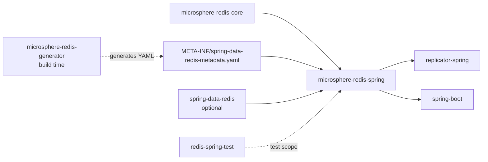
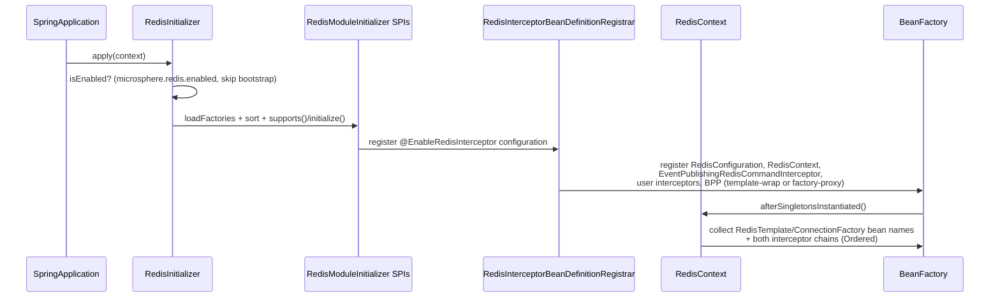
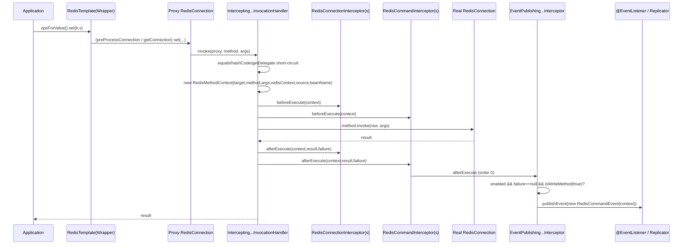

# microsphere-redis-spring — Developer Guide

| Field | Value |
|-------|-------|
| Module | `microsphere-redis-spring` |
| Git branch | `release` (0.2.x, latest release `0.2.14`) |
| Layer | Core Spring integration (the heart of the framework) |
| Dependencies | `microsphere-redis-core` (compile), `spring-data-redis` (optional), `snakeyaml`, `jakarta.servlet-api` (optional), `microsphere-spring-context` (optional) |

## Module Position & Dependencies



This module turns the static command metadata (produced by the generator, modeled by core) into a
**runtime interception pipeline**: every `RedisConnection` method call passes through an ordered chain
of interceptors, and successful write commands are republished as `RedisCommandEvent`s.

## Package Layout

```
io.microsphere.redis.spring
    annotation/    # @EnableRedisConfiguration / @EnableRedisContext / @EnableRedisInterceptor + registrars
    beans/         # RedisTemplate wrappers, BeanPostProcessors, WrapperProcessors
    config/        # RedisConfiguration (runtime switches bound to Environment)
    connection/    # DynamicRedisConnectionFactory (+ web cleanup listener)
    context/       # RedisContext, RedisInitializer, RedisModuleInitializer SPI + interceptor initializer
    event/         # RedisOperationEvent, RedisCommandEvent, RedisConfigurationPropertyChangedEvent
    interceptor/   # InvocationHandler, RedisMethodContext, interceptor interfaces, event publisher
    metadata/      # SpringRedisMetadataLoader, SpringRedisMetadataRepository
    serializer/    # ~20 typed serializers + HoldingValueRedisSerializerWrapper + RedisCommandEventSerializer
    util/          # RedisConstants (property keys), RedisSpringUtils, SpringRedisCommandUtils
```

## Source Analysis

### annotation package — three escalating `@Enable*` entry points

- `@EnableRedisConfiguration` registers the `RedisConfiguration` bean only (switches + env binding).
- `@EnableRedisContext` = `@EnableRedisConfiguration` + `@Import(RedisContextBeanDefinitionRegistrar.class)`,
  registering the `RedisContext` bean (`microsphere:redisContext`).
- `@EnableRedisInterceptor` = `@EnableRedisContext` + `@Import(RedisInterceptorBeanDefinitionRegistrar.class)`.
  Its attributes drive the whole wiring:
  `wrapRedisTemplates()` (bean-name patterns, default from `microsphere.redis.wrapped-redis-templates`, `*`),
  `exposeCommandEvent()` (default `true`, overridable via `microsphere.redis.command-event.exposed`),
  `sources()` (`BeanSource.BEAN_FACTORY` / `SPRING_FACTORIES` / `JAVA_SERVICE_PROVIDER` — where to
  discover user interceptors).
- `RedisInterceptorBeanDefinitionRegistrar.registerBeanDefinitions(...)` (RedisInterceptorBeanDefinitionRegistrar.java:78)
  reads those attributes, resolves the wrapped-template patterns, then (line 108) registers:
  the `EventPublishingRedisCommandInterceptor` bean (when exposure is on), the interceptor beans discovered
  from the selected sources, and — depending on `wrapRedisTemplates` — either the
  `RedisTemplateWrapperBeanPostProcessor` (explicit template names) or the
  `RedisConnectionFactoryProxyBeanPostProcessor` (factory-level proxying).

### context package — bootstrap

- `RedisInitializer` (RedisInitializer.java:46) is an `ApplicationContextInitializer` registered through
  `spring.factories`. Its static block triggers `SpringRedisMetadataRepository.init()`; `isEnabled(...)`
  (line 74) skips bootstrap contexts and honors `microsphere.redis.enabled`; `initialize(...)` (line 55)
  loads every `RedisModuleInitializer` via `SpringFactoriesLoader`, sorts by `Ordered`, and calls
  `supports()` → `initialize()` on each.
- `RedisModuleInitializer` is the module-level SPI: `supports(context, registry)` + `initialize(context, registry)`.
- `RedisInterceptorModuleInitializer` implements it and is the default factory-less auto-wiring path: it
  registers an internal `@Configuration` annotated with
  `@EnableRedisInterceptor(wrapRedisTemplates = DEFAULT_WRAP_REDIS_TEMPLATE_PLACEHOLDER)`
  (two variants — one with `exposeCommandEvent = false` — chosen by the property defaults).
- `RedisContext` (RedisContext.java) implements `SmartInitializingSingleton`, `ApplicationContextAware`,
  `BeanFactoryAware`, `BeanClassLoaderAware`. In `afterSingletonsInstantiated()` (line 99) it collects:
  `RedisConfiguration`, all `RedisTemplate` bean names, all `RedisConnectionFactory` bean names, and both
  interceptor lists (`RedisConnectionInterceptor`, `RedisCommandInterceptor`, sorted by `Ordered`).
  `getRedisConfiguration()` lazily falls back to `RedisConfiguration.get(beanFactory)`; `isEnabled()` (line 181)
  delegates to the configuration.

### config package

`RedisConfiguration` (RedisConfiguration.java) is the mutable runtime view of the property keys in
`RedisConstants` (`microsphere.redis.enabled`, `.interceptor.enabled`, `.command-event.exposed`,
`.wrapped-redis-templates`, `.fail-fast`). It listens to `RedisConfigurationPropertyChangedEvent`
(implements `ApplicationListener<...>`) so spring-cloud can flip switches at runtime; `get(beanFactory)`
(line 90) is the static locator used across the module.

### interceptor package — the pipeline

- `InterceptingRedisConnectionInvocationHandler` (InterceptingRedisConnectionInvocationHandler.java:52) —
  the JDK `InvocationHandler` behind every proxied connection. Constructor (line 100) caches the two
  interceptor lists plus boolean/count fast-path fields. `invoke(...)` (line 117):
  1. short-circuits `equals` (proxy identity), `hashCode` (`identityHashCode(proxy)`), `getDelegate`
     (returns the raw connection) — no context created;
  2. builds a `RedisMethodContext<RedisConnection>` (line 133);
  3. `beforeExecute` (line 153) runs the **connection interceptors first, then command interceptors**;
  4. reflects the call onto the raw connection; any `Throwable` is unwrapped via `getCause()` (line 142)
     so callers see the original exception, not `InvocationTargetException`;
  5. `finally`-phase `afterExecute` (line 172) runs both chains with `(result, failure)`.
  Interceptor failures never break business calls: each is caught and routed to
  `interceptor.handleError(context, before, result, failure, interceptionFailure)` (lines 165, 184).
- `RedisMethodInterceptor<T>` — the contract, extends `Ordered`, all methods are defaults:
  `beforeExecute(context)` / `beforeExecute(target, method, args, sourceBeanName)`,
  `afterExecute(context, result, failure)` / the full-arg variant, and `handleError(...)`.
  Sub-interfaces bind the generic: `RedisConnectionInterceptor extends RedisMethodInterceptor<RedisConnection>`,
  `RedisCommandInterceptor extends RedisMethodInterceptor<RedisCommands>`.
- `RedisMethodContext<T>` (RedisMethodContext.java) — the Context Object handed to every interceptor.
  A `ThreadLocal<RedisMethodContext<?>>` (line 85) exposes `set/get/clear` statics (lines 517–537) so
  serializers and nested code can reach the current call without parameter threading. It carries target,
  method, args, source bean/name, live `RedisContext`, environment-derived helpers (`getApplicationName`,
  `isEnabled`, `isCommandEventExposed`), timing (`start()`/`stop()` nanos, `getDuration(TimeUnit)`),
  an attribute map, and write-introspection: `isWriteMethod()` resolves the method against the generator
  metadata, `getParameters()`/`getParameter(name)` bind `ParameterMetadata` to runtime values.
- `EventPublishingRedisCommandInterceptor` (EventPublishingRedisCommandInterceptor.java:56) — the built-in
  command interceptor, order `0`. In `afterExecute` (line 87) it publishes a `RedisCommandEvent` only when
  `exposeCommandEvent` is on, the call succeeded (`failure == null`) and `context.isWriteMethod(true)` —
  i.e. **read commands never generate events**.

### event package

- `RedisOperationEvent extends ApplicationEvent` — base for Redis lifecycle events.
- `RedisCommandEvent` (event/RedisCommandEvent.java) — snapshot of one write command: method, interface
  name, method name, parameter types/count, args, application name, source bean name, a mutable
  `serializationVersion` byte (used by `RedisCommandEventSerializer`), and the execution timestamp
  (later reused as the Kafka record timestamp by the replicator).
- `RedisConfigurationPropertyChangedEvent extends ApplicationContextEvent` — carries the changed
  property names plus the `Environment`; consumed by `RedisConfiguration`.

### beans package — how connections get intercepted

Two mutually exclusive strategies:

1. **Template wrapping** (when `wrapRedisTemplates` names templates): `RedisTemplateWrapperBeanPostProcessor`
   replaces `RedisTemplate`/`StringRedisTemplate` bean definitions with `RedisTemplateWrapper<K,V>` /
   `StringRedisTemplateWrapper`. Both extend the Spring originals and override
   `preProcessConnection(connection, existingConnection)` (RedisTemplateWrapper.java:76) to wrap every
   borrowed connection via `RedisConnectionFactoryProxyBeanPostProcessor.newProxyRedisConnection(...)`,
   gated by `isEnabled()` (line 89). This captures all non-`RedisTemplate` code paths within those templates.
2. **Factory proxying** (default, `wrapRedisTemplates` empty): `RedisConnectionFactoryProxyBeanPostProcessor`
   (RedisConnectionFactoryProxyBeanPostProcessor.java:74) wraps each `RedisConnectionFactory` bean in an
   AOP `ProxyFactory` whose advice (line 98) intercepts `getConnection()`: if `RedisContext.isEnabled()`
   the returned raw connection becomes a JDK proxy implementing `{RedisConnection, DelegatingWrapper}`
   (lines 76, 128–133). The pre-proxy factory is stashed as a `BeanDefinition` attribute and recovered by
   `getRawRedisConnectionFactory(beanFactory, beanName)` (line 148) — needed by the replicator to replay
   commands without recursion.

`WrapperProcessors` + `HoldingValue{Redis,String}TemplateWrapperProcessor` handle the holding-value
serializer installation described next.

### serializer package — holding values & wire format

- `AbstractSerializer<T>` — Template Method: final `serialize`/`deserialize` bookkeeping (byte-length
  calc, target type) around abstract `doSerialize`/`doDeserialize`.
- `Serializers` — registry of static singletons (`BOOLEAN_SERIALIZER`, `RANGE_SERIALIZER`,
  `WEIGHTS_SERIALIZER`, …) with `DEFAULT_SERIALIZER` = Spring's `JdkSerializationRedisSerializer` and
  `STRING_SERIALIZER`; lookup by target type.
- Typed serializers exist because Redis command parameters are *value objects*
  (`Expiration`, `Boundary`, `Range`, `GeoLocation`, `Point`, `SortParameters`, `RedisZSetCommands.Range/Weights`),
  not `Serializable` POJOs. `RangeModel` is an `Externalizable` carrier for `Range`.
- `HoldingValueRedisSerializerWrapper` — the **raw ↔ object bridge**: before delegating, it stores the
  pair `(object, bytes)` into core's `ValueHolder` ThreadLocal. This is what lets interceptors see the
  *original Java object* of an argument even after the template has serialized it to bytes.
- `RedisCommandEventSerializer` — the wire format for replication; registered as a
  `RedisSerializer` SPI service in `spring.factories`. Versioned via the `serializationVersion` byte.

### metadata package — runtime metadata repository

- `SpringRedisMetadataLoader implements RedisMetadataLoader` (registered in
  `META-INF/services/io.microsphere.redis.metadata.RedisMetadataLoader`) loads
  `META-INF/spring-data-redis-metadata.yaml` — the file the generator module writes at build time.
- `SpringRedisMetadataRepository` (SpringRedisMetadataRepository.java) is the in-memory index, built once
  in a static `initCache()`:
  - `redisCommandInterfacesCache`: every `Redis*Commands` interface of `RedisConnection` by class name;
  - `redisCommandBindings`: interface name → `Function<RedisConnection,Object>` locating the command
    sub-object (e.g. `keyCommands()`), so metadata can be validated against live proxies;
  - `methodInfoCache` (capacity 4×1024): triple-keyed map — by `index`, by `Method`, and by
    `buildMethodId(method)` — serving `getMethodIndex(Method)`, `getRedisCommandMethod(int)`,
    `getRedisCommandMethod(interfaceName, methodName, parameterTypes...)`, plus write-command queries
    (`isWriteCommandMethod`, `getWriteParameterMetadataList`).
  Lookup by compact `int` index is the hot path used by `RedisMethodContext.isWriteMethod()` and by the
  replicator when replaying events across versions.

### connection/dynamic package

`DynamicRedisConnectionFactory` implements `RedisConnectionFactory` + `SmartInitializingSingleton`: it
holds a default factory bean name and a **thread-local target override** (`switchTarget(beanName)` /
`clearTarget()` / `getTargetBeanName()`), so application code can route the current thread to another
Redis instance (multi-tenant / migration scenarios). `DynamicRedisConnectionFactoryCleanerListener`
(a `ServletRequestListener`) calls `clearTarget()` on `requestDestroyed` to avoid leaking the ThreadLocal
in servlet containers.

## Design Patterns

| Pattern | Where | Notes |
|---------|-------|-------|
| JDK Dynamic Proxy | `InterceptingRedisConnectionInvocationHandler`, `newProxyRedisConnection` | interfaces-only proxying of `RedisConnection` + `DelegatingWrapper` |
| Proxy (AOP) | `RedisConnectionFactoryProxyBeanPostProcessor.doPostProcessAfterInitialization` | `ProxyFactory` advice on `getConnection()` |
| Decorator | `RedisTemplateWrapper`, `StringRedisTemplateWrapper`, `HoldingValueRedisSerializerWrapper` | subclass/wrapper preserving Spring contracts |
| Chain of Interceptors | `RedisContext` interceptor lists + before/after phases | connection chain first, command chain second, both `Ordered` |
| Context Object | `RedisMethodContext` (plus its `ThreadLocal` accessors) | one object carries target/args/config/timing/attributes |
| Observer | `EventPublishingRedisCommandInterceptor` → `RedisCommandEvent`; `RedisConfiguration` ← `RedisConfigurationPropertyChangedEvent` | Spring `ApplicationEvent` machinery |
| Template Method | `AbstractSerializer.serialize/deserialize` → `doSerialize/doDeserialize` | |
| Registry / Index | `Serializers`, `SpringRedisMetadataRepository.methodInfoCache` | triple-keyed, int-index hot path |
| SPI | `RedisMetadataLoader` (services), `RedisModuleInitializer` (spring.factories), `RedisSerializer` (spring.factories) | |
| BeanDefinition mutation | registrar + `RedisTemplateWrapperBeanPostProcessor` | switches bean classes before instantiation |
| Thread-Local Session State | `DynamicRedisConnectionFactory.switchTarget`, `ValueHolder` | web listener clears per request |

## Key Flows

### Bootstrap sequence



### One Redis command



### Holding-value restoration (object visible after serialization)

```mermaid
flowchart LR
    A[Template serializes argument to bytes] --> B[HoldingValueRedisSerializerWrapper.serialize]
    B --> C[ValueHolder ThreadLocal: put object ↔ bytes both directions]
    B --> D[delegate to real serializer]
    E[Interceptor reads context args] --> F{arg is byte[]?}
    F -- yes --> G[ValueHolder.getValue(bytes) → original object]
    F -- no --> H[use object directly]
```

## Testing Strategy

- Unit/component tests live under `microsphere-redis-spring/src/test/java`, e.g. the `@EnableRedis*`
  annotation tests (`EnableRedisInterceptorTest`, `RedisContextTest`, `RedisConfigurationTest`) and
  serializer round-trip tests.
- Integration tests run with `microsphere-redis-spring-test` (`AbstractRedisTest`, `RedisConfig`) against a
  local Redis (`docker/` compose files in the repo); `SET_METHOD`/`SET_METHOD_ARGS` constants give
  interceptor tests a canonical write command to assert on.
- Metadata correctness is enforced at build time, not test time: the generator validates every index/id
  against `META-INF/redis-commands` before the YAML ships.

## Extension Points

- Implement `RedisCommandInterceptor` / `RedisConnectionInterceptor` and let the registrar discover it
  (`BeanSource.BEAN_FACTORY`, `SPRING_FACTORIES`, or `JAVA_SERVICE_PROVIDER`).
- Register your own `RedisModuleInitializer` in `spring.factories` to add module-level beans.
- Contribute metadata by implementing `RedisMetadataLoader` (services file) — merged by `RedisMetadata.merge`.
- Listen for `RedisCommandEvent` with `@EventListener`; use `event.getArg(i)` plus `ValueHolder` to recover
  original objects.
- Plug custom serializers through the `RedisSerializer` SPI or `Serializers` lookups.

## Links

- User guide: [../../user-guide/current/microsphere-redis-spring.md](../../user-guide/current/microsphere-redis-spring.md)
- Chinese: [../zh/microsphere-redis-spring.md](zh/microsphere-redis-spring.md)
- Previous: [microsphere-redis-generator](./microsphere-redis-generator.md) · Next: [microsphere-redis-spring-test](./microsphere-redis-spring-test.md)
