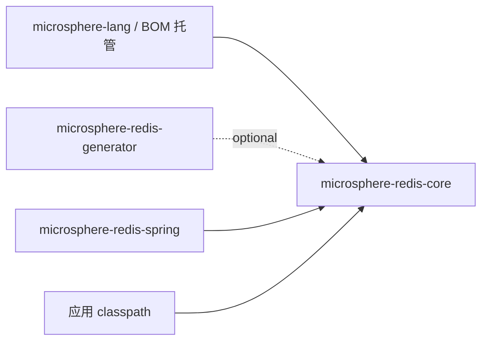
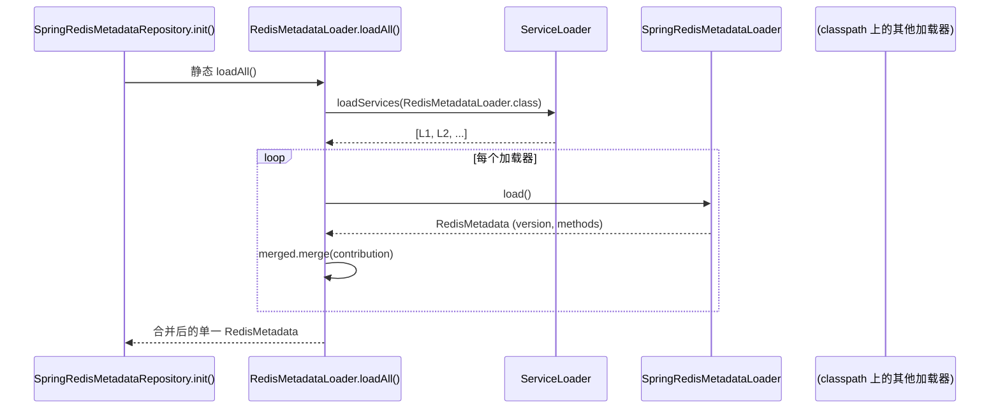

# microsphere-redis-core — 开发者文档

| 字段 | 值 |
|------|-----|
| 模块 | `microsphere-redis-core` |
| Git 分支 | `release`（0.2.x，最新发布 `0.2.14`） |
| 层次 | 基础层 |
| 消费方 | `microsphere-redis-spring`（compile）、`microsphere-redis-generator`（optional） |

## 模块位置与依赖



本模块仅编译依赖 `io.microsphere` 工具（`SymbolConstants`、`ArrayUtils`、`ServiceLoaderUtils`、`@Nonnull`），
**不依赖 Spring**——因此构建期工具与运行期集成都能复用这套元数据模型。

## 包结构

```
io.microsphere.redis.metadata   # 命令元数据模型 + 加载器 SPI
io.microsphere.redis.util       # RawValue、ValueHolder、RedisCommandUtils、RedisUtils
resources/META-INF/
    redis-commands              # 行式的全量 Redis 命令目录
    redis-write-commands        # 写命令子集目录
```

## 源码解析

### metadata 包

该模型是**纯数据层**，面向 SnakeYAML 绑定（默认构造器 + JavaBeans setter）：

- `RedisMetadata` — `{version, List<MethodMetadata>}`。`getMethods()` 惰性初始化 `LinkedList`；
  `merge(RedisMetadata another)`（RedisMetadata.java:113）采纳对方的 `version`（后写入者生效）并追加其
  methods——这正是 `loadAll()` 对各 SPI 贡献做折叠（fold）的基础。
- `MethodMetadata` — 七个字段（`index`、`interfaceName`、`methodName`、`parameterNames`、`parameterTypes`、
  `commands`、`write`）。`index` 并非任意值：它由声明接口 + 方法名 + JVM 参数类型名经
  `RedisCommandUtils.buildMethodIndex(...)` 计算得到，为每个命令方法提供稳定的紧凑 id，可在热路径上当 map 键使用。
- `MethodInfo` — 运行期三元组：`java.lang.reflect.Method` + `MethodMetadata` + `List<ParameterMetadata>`；
  `id` 在构造时一次性计算（`buildMethodId(method)`）。
- `ParameterMetadata` / `Parameter` — 参数侧的镜像对：元数据（index/type/name，不可变）与运行期绑定
  （`Parameter` 持有实际 `value` 及可变的 `rawValue` 字节数组）。
- `RedisMetadataLoader` — SPI。`loadAll()`（RedisMetadataLoader.java:68）调用
  `ServiceLoaderUtils.loadServices(RedisMetadataLoader.class)` 并 merge 所有贡献。

### util 包

- `RawValue` — `record RawValue(byte[] data)`；字节数组查找的 identity 键（record 的
  `equals`/`hashCode` 比较数组内容）。
- `ValueHolder` — 基于 **ThreadLocal 单例**（`holder = withInitial(() -> new ValueHolder(4))`，
  ValueHolder.java:58）封装 `Map<Object,Object> cache`。`set(value, rawValue)` 双向存储；
  `getValue(byte[])` / `getRawValue(Object)` 双向查询；`get()` 返回当前线程实例，`clear()` 清除。
  契约：线程工作结束必须清除（Spring 模块的序列化器与拦截器上下文正是这样做的），否则条目会跨池化请求泄漏。
- `RedisCommandUtils` — `implements Utils` 的抽象 final 风格工具类。静态初始化块通过
  `RedisUtils.loadResource(...)` 急切加载两个 META-INF 目录。命令判断就是简单的 `Set.contains`；
  `buildMethodId/Signature/Index` 方法族定义了生成器与运行期仓库共享的规范 id 语法（这是二者无需通信即可
  对同一 `index` 达成一致的原因）。
- `RedisUtils` — classpath 读取抽象：`loadResource` / `loadResources` 接受
  `ThrowableFunction<InputStream,T>`；`CLASS_LOADER` 默认为 microsphere 默认类加载器。本仓库所有资源解析
  （命令目录、元数据 YAML）都经由此处。

## 设计模式

| 模式 | 位置 |
|------|------|
| **SPI / ServiceLoader** | `RedisMetadataLoader.loadAll()` 发现实现；Spring 模块在 `META-INF/services` 注册 `SpringRedisMetadataLoader` |
| **组合 / Merge** | `RedisMetadata.merge` 折叠各贡献；版本后写生效 |
| **不可变值对象** | `RawValue` record；`ParameterMetadata`；`MethodInfo`（final 字段、预计算 id） |
| **线程局部上下文** | `ValueHolder` — 每线程的对象↔字节缓存 |
| **工具类（不可实例化）** | `RedisCommandUtils`、`RedisUtils` 的私有构造器 |
| **JavaBean/DTO 反序列化** | `RedisMetadata`、`MethodMetadata` 的 setter 供 SnakeYAML 使用 |

## 关键流程

### 启动期元数据聚合



### 原始值回环（ValueHolder 存在的意义）

```mermaid
flowchart LR
    A[template.opsForValue().set keyObj, valueObj] --> B[RedisSerializer 序列化为字节]
    B --> C[HoldingValueRedisSerializerWrapper 将 keyObj↔bytes、valueObj↔bytes 写入 ValueHolder.get()]
    C --> D[RedisConnection.set bytes, bytes — 被拦截]
    D --> E[拦截器读取字节参数]
    E --> F[ValueHolder.getValue bytes -> 还原原始 Java 对象]
```

## 测试策略

`src/test/java` 覆盖每个类：`RedisMetadataTest`、`MethodMetadataTest`、`ParameterMetadataTest`、
`ParameterTest`、`MethodInfoTest`（POJO 契约含 `merge`）、`RedisMetadataLoaderTest` +
`TestRedisMetadataLoader`（通过 `src/test/resources/META-INF/services/...` 验证 SPI 注册）、`RawValueTest`、
`ValueHolderTest`、`RedisCommandUtilsTest`、`RedisUtilsTest`。

## 扩展点

- **贡献元数据**：实现 `RedisMetadataLoader`，注册到 `META-INF/services`。
- **扩展命令目录**：目录是由 `RedisUtils.loadResource` 读取的 classpath 资源；姊妹方法
  `loadResources`（同名资源的全部匹配）供需要多资源视图的工具使用。
- **复用 id 语法**：任何必须与运行期方法索引保持一致的外部工具，应调用
  `RedisCommandUtils.buildMethodIndex` 而非自行哈希。

## 链接

- 用户文档：[../../user-guide/current/zh/microsphere-redis-core.md](../../../user-guide/current/zh/microsphere-redis-core.md)
- [Generator 开发者文档](./microsphere-redis-generator.md) — 本模块 YAML 契约的构建期生产者
- [Spring 开发者文档](./microsphere-redis-spring.md) — 运行期消费者
