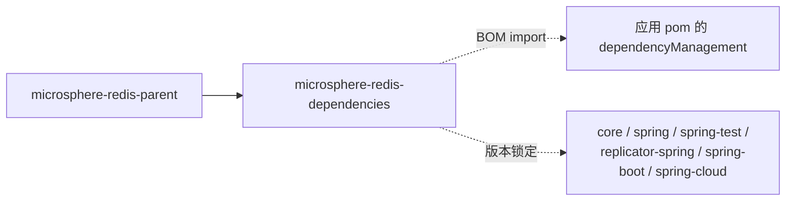

# microsphere-redis-dependencies — 开发者文档

| 字段 | 值 |
|------|-----|
| 模块 | `microsphere-redis-dependencies` |
| Git 分支 | `release`（0.2.x，最新发布 `0.2.14`） |
| 层次 | 构建：BOM（pom 打包，仅 `dependencyManagement`） |
| 消费方 | 以 BOM 方式 import 它的应用与库 |

## 模块位置



## 源码解析（仅 pom）

`microsphere-redis-dependencies/pom.xml` 恰好托管**六个可消费 jar 模块**的版本，全部为
`${revision}`（microsphere-redis-dependencies/pom.xml:24–58）：

| artifactId | 行号 |
|------------|------|
| `microsphere-redis-core` | :26 |
| `microsphere-redis-spring` | :32 |
| `microsphere-redis-spring-test` | :38 |
| `microsphere-redis-replicator-spring` | :44 |
| `microsphere-redis-spring-boot` | :50 |
| `microsphere-redis-spring-cloud` | :56 |

`microsphere-redis-generator` 是刻意**缺席**的：它属于构建期工具（exec-maven-plugin 驱动），
不是运行期依赖，绝不应出现在应用侧 BOM 中。

由于其 parent 是 `microsphere-redis-parent`，应用 import 本 BOM 时也会与这些模块编译所依据的
Spring Data Redis / Spring Boot 版本传递性对齐。

## 构建体系说明

- flatten 插件在发布期解析 `${revision}`，消费者看到的是具体版本（如 `0.2.14`）。
- 纯 BOM 构件从不添加依赖，只锁定版本；消费者仍自行决定依赖哪个模块。

## 扩展点

- 典型用法（Spring Boot 应用）：

```xml
<dependencyManagement>
    <dependencies>
        <dependency>
            <groupId>io.microsphere</groupId>
            <artifactId>microsphere-redis-dependencies</artifactId>
            <version>0.2.14</version>
            <type>pom</type>
            <scope>import</scope>
        </dependency>
    </dependencies>
</dependencyManagement>
```

之后六个模块的 `<dependency>` 条目均可省略 `<version>`。

## 链接

- 用户文档：[../../user-guide/current/zh/microsphere-redis-dependencies.md](../../../user-guide/current/zh/microsphere-redis-dependencies.md)
- English: [../microsphere-redis-dependencies.md](../microsphere-redis-dependencies.md)
- 上一篇：[microsphere-redis-parent](./microsphere-redis-parent.md) · 返回索引：[README](../../README.md)
