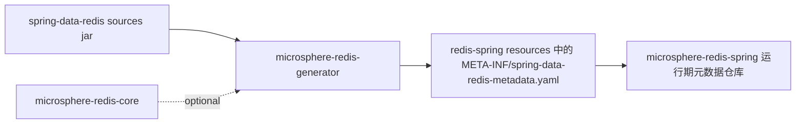
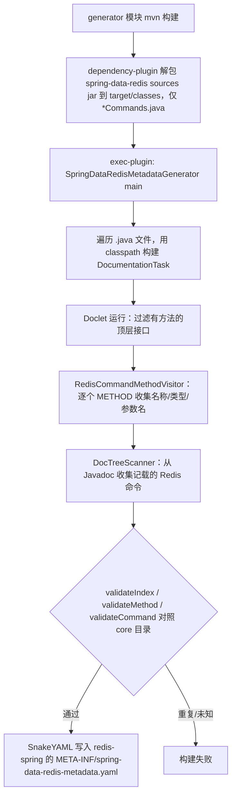

# microsphere-redis-generator — 开发者文档

| 字段 | 值 |
|------|-----|
| 模块 | `microsphere-redis-generator` |
| Git 分支 | `release`（0.2.x，最新发布 `0.2.14`） |
| 层次 | 工具（构建期） |
| 消费方 | 运行期无消费方 —— 由 `exec-maven-plugin` 在构建期间调用 |

## 用途

生成 `microsphere-redis-spring/src/main/resources/META-INF/spring-data-redis-metadata.yaml`——
把 Spring Data Redis 每个顶层 `Redis*Commands` 接口方法与 Redis 服务端命令的映射关系写入该文件。
实现方式：用 JDK 文档工具 + 自定义 `Doclet` 解析 `spring-data-redis` 的 **sources jar**。

## 模块依赖



所有依赖均为 `optional`（`microsphere-redis-core`、`spring-data-redis`、`reactor-core`、`snakeyaml`、
`microsphere-lang-model`、`microsphere-annotation-processor`）：本模块是构建期工具，绝不是运行期节点。

## 构建装配（pom）

两个插件协作 —— 这就是本模块的全部"API"：

1. **maven-dependency-plugin**（`src-dependencies` execution，阶段 `generate-resources`）：解包
   `org.springframework.data:spring-data-redis:*:sources.jar`，仅包含
   `org/springframework/data/redis/connection/*Commands.java`，输出到 `${sourcePath}`
   （默认 `${project.build.directory}/classes`）。
2. **exec-maven-plugin**（`exec` goal）：执行
   `java -classpath <模块 classpath> --add-opens=java.base/java.lang.invoke=ALL-UNNAMED
   io.microsphere.redis.generator.metadata.SpringDataRedisMetadataGenerator ${sourcePath} <目标 yaml>`。

因此每次构建该模块都会重新生成：先解包源码，再由生成器遍历。

## 源码解析

### SpringDataRedisMetadataGenerator

`main(String[] args)`（SpringDataRedisMetadataGenerator.java:67）：

1. 校验参数 `<source-path> <target-file-path>`。
2. `walkFileTree` 收集源码路径下所有 `.java` 文件。
3. 构建 `DocumentationTool`（`javax.tools.ToolProvider.getSystemDocumentationTool()`），并把当前 JVM
   classpath 设为 `CLASS_PATH`，使 doclet 能解析类型并加载类。
4. 启动绑定到 `SpringDataRedisMetadataGenerationDoclet.class` 的 `DocumentationTask`，
   仅带一个选项 `--metadata-file=<target>`。
5. 静态初始化块将默认 `Locale` 锁定为 `ENGLISH`（保证消息解析的确定性）。

### SpringDataRedisMetadataGenerationDoclet

实现新版 `jdk.javadoc.doclet.Doclet` 接口：

| 元素 | 职责 |
|------|------|
| `METADATA_FILE_OPTION_NAME = "--metadata-file"` | 支持的选项（`StandardOption`，1 个参数），其 `process` 捕获输出路径 |
| `getSupportedSourceVersion()` | 最新 JDK 源码版本 |
| `run(DocletEnvironment)` | 委托给 `generateSpringDataRedisMetadata` |
| `generateSpringDataRedisMetadata`（第 227 行） | 只保留有声明方法的顶层接口，逐个交给 `RedisCommandMethodVisitor`；随后执行 `validateIndex` + `validateMethod` 并写出 YAML |
| `getSpringDataRedisVersion()` | `RedisCommands.class.getPackage().getImplementationVersion()` —— 成为 YAML 的 `version:`（如 `3.5.10`） |
| `RedisCommandMethodVisitor extends ElementScanner9` | 访问 `Redis*Commands` 接口的 METHOD 元素；提取方法名、规范化的参数类名（`normalizeClassName` 剥离泛型但保留 `[]` 等维度标记）、来自 Javadoc 的参数名以及命令关联 |
| `RedisCommandMethodDocumentVisitor extends DocTreeScanner` | 解析 Javadoc 注释树，收集每个方法所记载的 Redis 命令名 |
| `deduceMethodParameterClass` | 对类型变量参数，借助 javac Tree API（`TreeScanner.visitMethod`）重新解析源码，找到类型参数的第一个 bound，无限定名的 bound 默认加 `java.lang.` 前缀，然后加载该类 |
| `validateCommand / validateIndex / validateMethod` | 将收集到的命令与 core 的目录交叉校验（`RedisCommandUtils.getRedisCommands()/getRedisWriteCommands()`）—— 日志对比"全部 Redis 命令"与"Spring Data Redis 支持的命令"；index/方法 id 重复会终止构建 |
| `writeSpringDataRedisMetadata` | 用 SnakeYAML 输出 `{version, methods: [...]}`，键为 `index, interfaceName, methodName, parameterNames, parameterTypes, commands, write` |
| `ReporterLoggerAdapter extends AbstractLogger` | 把 microsphere 日志适配到 doclet `Reporter`（error/warn ↔ `Diagnostic.Kind`） |

### YAML 输出契约

生成的文件可直接加载进 core 的 `RedisMetadata`（参见
[core 开发者文档](./microsphere-redis-core.md)）：

```yaml
version: 3.5.10
methods:
- index: 498782566
  interfaceName: org.springframework.data.redis.connection.RedisHyperLogLogCommands
  methodName: pfAdd
  parameterNames: [key, values]
  parameterTypes: ['[B', '[[B']
  commands: [PFADD]
  write: true
```

`index` 恒等于 `RedisCommandUtils.buildMethodIndex(interfaceName, methodName, parameterTypes)`——
这一等式就是运行期 `SpringRedisMetadataRepository` 使用的 join key。

## 设计模式

| 模式 | 位置 |
|------|------|
| **访问者（双重分派）** | `ElementScanner9` + `DocTreeScanner` 遍历 javac 元素/注释树；嵌套 `TreeScanner` 重解析源码 |
| **策略 / 插件** | doclet 作为任务行为被注入 `DocumentationTool.getTask(...)` |
| **适配器** | `ReporterLoggerAdapter` 桥接 `Reporter` ↔ microsphere `Logger` |
| **模板方法** | `StandardOption implements Option` 固定 `getKind()`/默认值，子类传入名称/参数个数/process |
| **流水线** | 解包源码 → doclet 解析 → 校验 → 生成 YAML |

## 生成流程



## 测试策略

本模块不为访问器编写单元测试；其测试夹具是签入仓库的
`src/test/resources/spring-data-redis-metadata.yaml`（格式见证），正确性在生成期由校验器强制，
并由 spring 模块的 `RedisMetadataRepositoryTest` / `SpringRedisMetadataLoaderTest`
（加载真实生成文件）断言保障。

## 维护提示

- 升级 Spring Data Redis 会重新生成 YAML（`version:` 头随之变化）；命令名漂移会以
  `validateCommand` 失败的形式暴露。
- `--add-opens=java.base/java.lang.invoke=ALL-UNNAMED` JVM 参数是必需的，因为 JDK 17 上使用了 javac 内部 API。
- 在 0.1.x 分支上，本模块仅在 JDK 9+ profile 下激活（参见
  [../../1.x/zh/microsphere-redis-generator.md](../../1.x/zh/microsphere-redis-generator.md)）。

## 链接

- 用户文档：[../../user-guide/current/zh/microsphere-redis-generator.md](../../../user-guide/current/zh/microsphere-redis-generator.md)
- [core 开发者文档](./microsphere-redis-core.md) —— doclet 校验所依据的命令目录 + id 语法
