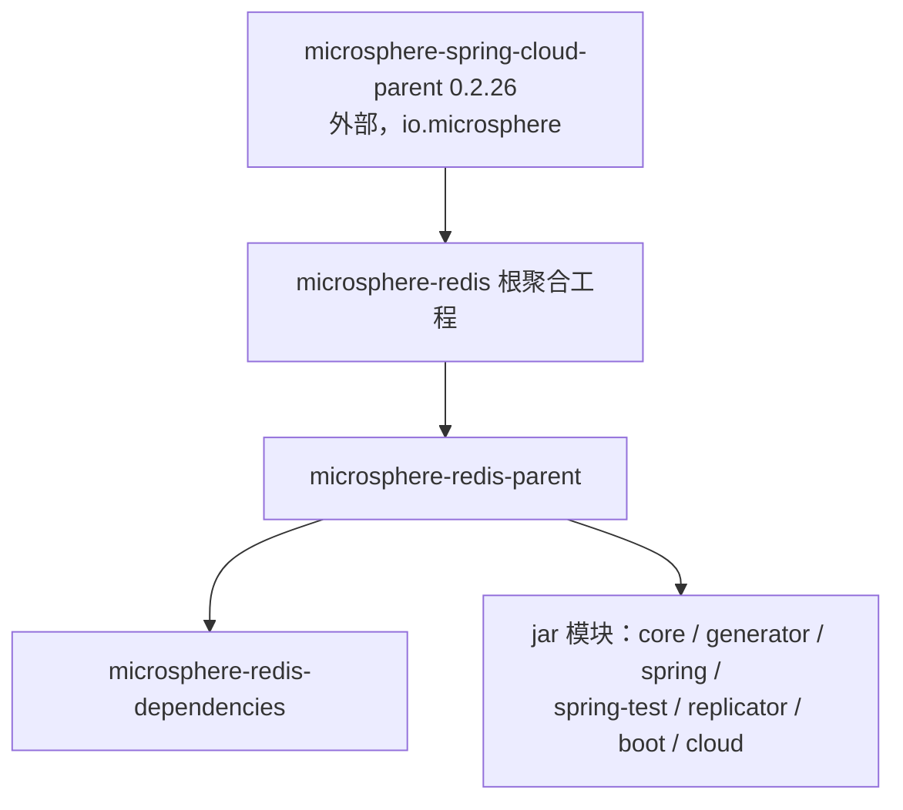

# microsphere-redis-parent — 开发者文档

| 字段 | 值 |
|------|-----|
| 模块 | `microsphere-redis-parent` |
| Git 分支 | `release`（0.2.x，最新发布 `0.2.14`） |
| 层次 | 构建：依赖管理父工程（pom 打包） |
| 消费方 | 每个 jar 模块的有效 parent 链 |

## 模块位置

注意根 reactor 承担两个角色：仓库根的 `pom.xml` 是**聚合器**（声明全部 8 个模块，设置
`revision=0.2.15-SNAPSHOT`、`java.version=17`，pom.xml:55–56），而 `microsphere-redis-parent`
是各 jar 模块所继承的**继承型父工程**。

## 源码解析（仅 pom）

- `microsphere-redis-parent/pom.xml` 声明 `<parent>microsphere-redis</parent>`，并导入
  `microsphere-spring-cloud-dependencies:0.2.26` BOM（microsphere-redis-parent/pom.xml:31–34，
  属性 `microsphere-spring-cloud.version`，第 23 行）。仅这一次导入就为 Spring Framework、
  Spring Boot、Spring Data Redis、Jackson、日志以及整个 `io.microsphere` 工具栈带来一致的版本 ——
  **任何 jar 模块的 pom 中都不会出现 version 标签**。
- 版本传播采用 `${revision}` + flatten-maven-plugin 约定：尽管 reactor 源码统一写 `${revision}`，
  模块发布时输出真实解析后的版本。
- Java 基线：`17`（从根属性继承），这正是 core 中 `record`（`RawValue`）以及现代 JDK 上
  基于 `ElementScanner9` 的 generator 得以成立的前提。

## 构建体系说明

- 发布流程（git 历史可见）：工作先合并 `main → release`，发布流水线出版本，随后版本号回 bump ——
  因此 `release` == 最新发布线，当前 tip 为 `0.2.15-SNAPSHOT`、已发布 `0.2.14`。
- CI 通过仓库的 `docker/` compose 文件与共享的 `setup-compose` GitHub action
  （当前 v2.3.0）在集成测试前拉起 Redis/Kafka。

## 扩展点

- 消费方式：把 `microsphere-redis-parent` 作为你的 `<parent>` 可获得完整托管栈；或仅在
  `dependencyManagement` 内导入 `microsphere-redis-dependencies`（见[下一篇](./microsphere-redis-dependencies.md)）。

## 链接

- 用户文档：[../../user-guide/current/zh/microsphere-redis-parent.md](../../../user-guide/current/zh/microsphere-redis-parent.md)
- English: [../microsphere-redis-parent.md](../microsphere-redis-parent.md)
- 上一篇：[microsphere-redis-spring-cloud](./microsphere-redis-spring-cloud.md) · 下一篇：[microsphere-redis-dependencies](./microsphere-redis-dependencies.md)
