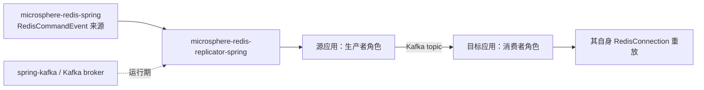
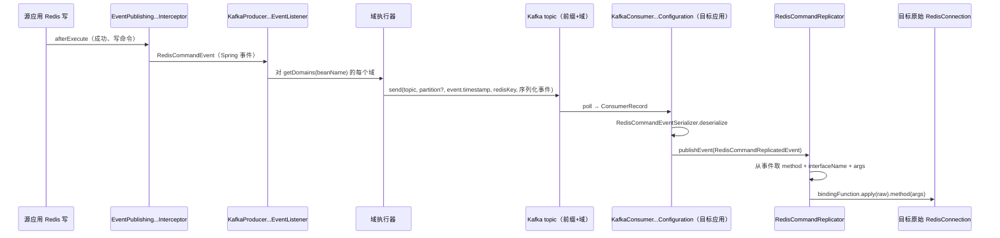

# microsphere-redis-replicator-spring — 开发者文档

| 字段 | 值 |
|------|-----|
| 模块 | `microsphere-redis-replicator-spring` |
| Git 分支 | `release`（0.2.x，最新发布 `0.2.14`） |
| 层次 | 可选附加模块：基于 Kafka 的 Redis 写命令复制 |
| 依赖 | `microsphere-redis-spring`（compile）、`spring-kafka`（optional） |

## 模块位置与依赖



replicator 消费 spring 模块 `EventPublishingRedisCommandInterceptor` 发布的 `RedisCommandEvent`，
并在另一个应用的 Redis 上重放它们 —— "不依赖 Redis 主从复制的写命令复制"。

## 包结构

```
io.microsphere.redis.replicator.spring
    RedisCommandReplicator.java          # 重放引擎（消费端）
    RedisReplicatorInitializer.java      # RedisModuleInitializer 桥（spring.factories）
    RedisReplicatorModuleInitializer.java# replicator 级 SPI（区分生产者/消费者角色）
    config/RedisReplicatorConfiguration  # 属性模型 + 热加载
    event/RedisCommandReplicatedEvent    # 包装 RedisCommandEvent + domain + 记录元数据
    kafka/
        KafkaRedisReplicatorConfiguration.java        # 共享基类（bootstrap servers、topic 前缀）
        KafkaRedisReplicatorModuleInitializer.java    # 注册生产者 + 消费者配置
        producer/KafkaProducerRedisReplicatorConfiguration.java
        producer/KafkaProducerRedisCommandEventListener.java
        producer/RedisComandEventPartitioner.java     # SPI：按事件选择分区
        consumer/KafkaConsumerRedisReplicatorConfiguration.java
```

## 源码解析

### 引导链

`RedisReplicatorInitializer` 在 `META-INF/spring.factories` 中注册于 **spring 模块自身的 SPI 键**之下：

```properties
io.microsphere.redis.spring.context.RedisModuleInitializer=\
io.microsphere.redis.replicator.spring.RedisReplicatorInitializer

io.microsphere.redis.replicator.spring.RedisReplicatorModuleInitializer=\
io.microsphere.redis.replicator.spring.kafka.KafkaRedisReplicatorModuleInitializer
```

于是 `RedisInitializer` → `RedisReplicatorInitializer`（检查 `microsphere.redis.replicator.enabled`）→
加载全部 `RedisReplicatorModuleInitializer` 实现 → `KafkaRedisReplicatorModuleInitializer` 条件化注册
生产者与消费者 `@Configuration`（生产者需要 classpath 上有 `spring-kafka`；消费者还要求
`microsphere.redis.replicator.consumer.enabled=true`，默认 **false** —— 在目标应用显式开启前，
复制只有生产端）。

### config/RedisReplicatorConfiguration（RedisReplicatorConfiguration.java:55）

带热加载的属性模型（监听 `RedisConfigurationPropertyChangedEvent`，第 145 行）：

| 属性 | 默认值 | 含义 |
|------|--------|------|
| `microsphere.redis.replicator.enabled` | `true` | 总开关（同时受 `microsphere.redis.enabled` 门控） |
| `microsphere.redis.replicator.consumer.enabled` | `false` | 启动消费者重放角色 |
| `microsphere.redis.replicator.domains` | `default` | 复制域列表（第 178 行） |
| `microsphere.redis.replicator.domains.{domain}.redis-templates` | *空* | 哪些模板 bean 名属于该域（第 196 行） |
| `...kafka.bootstrap.servers` | `${spring.kafka.bootstrap-servers:127.0.0.1:9092}` | `KafkaRedisReplicatorConfiguration` 中的回退链 |
| `...kafka.topic-prefix` | `redis-replicator-event-topic-` | **每域一个 topic**：前缀 + 域名 |
| `...kafka.listener.poll-timeout` | `10000`（毫秒） | 消费者轮询循环（KafkaConsumerRedisReplicatorConfiguration.java:79） |
| `...kafka.listener.concurrency` | `1` | 生效值 = `max(topic 数, 配置值)` |

`getDomains(sourceBeanName)` 把一个事件映射回所有"模板列表包含该事件 source bean 名"的域 ——
一个事件可以向多个域扇出。

### 生产者侧

`KafkaProducerRedisCommandEventListener`（KafkaProducerRedisCommandEventListener.java:35）实现
`ApplicationListener<RedisCommandEvent>`：

- `afterSingletonsInstantiated()`（第 138 行）解析 replicator 配置、专用
  `KafkaTemplate<byte[], byte[]>`（原始字节序列化器 —— 事件字节来自
  `RedisCommandEventSerializer`）、**可选**的 `RedisComandEventPartitioner` bean，
  并按域数量构建固定线程池（第 74 行）。
- `onRedisCommandEvent`（第 80 行）：对 `event.getSourceBeanName()` 的每个域，提交
  `sendRedisReplicatorKafkaMessage(domain, event)` —— 发送永不阻塞 Redis 调用线程。
- `sendRedisReplicatorKafkaMessage`（第 88 行）：`topic = 前缀 + domain`；
  `key = generateKafkaKey(event)`（第 115 行 —— Redis 的 *key*：普通命令取 arg 0，
  `RedisCommands.execute` 取 arg 1 的首个 `byte[]`）；`value = serialize(event)`；
  分区取 partitioner 或 `null`（交给 Kafka 自身按 key 哈希）；
  **时间戳 = `event.getTimestamp()`**，使重放顺序在同一分区内跟随原始执行顺序。
- `onComplete`（第 101 行）记录发送成败 —— 失败只记日志、不抛出。

`RedisComandEventPartitioner`（`Integer partition(RedisCommandEvent)`）是顺序性 SPI：
返回分区，使触及同一 Redis key/keyspace 的命令串行经过同一个 Kafka 分区。

### 消费者侧

`KafkaConsumerRedisReplicatorConfiguration`（consumer，第 47 行）继承共享基类并装配一个
监听容器（其 `@Bean`，第 118 行），group id 前缀为 `Redis-Replicator-`。对每条
`ConsumerRecord<byte[], byte[]>`（第 139 行）：`consumeRecord`（第 145 行）用
`RedisCommandEventSerializer` 反序列化，包装为 `RedisCommandReplicatedEvent(sourceEvent, domain)`
（第 159 行）并**作为应用事件发布**（第 152 行）—— 重放与传输彻底解耦。

### 重放引擎

`RedisCommandReplicator`（RedisCommandReplicator.java:26），bean 名 `microsphere:redisCommandReplicator`：

```java
Method method = redisCommandEvent.getMethod();                       // :49
String interfaceNme = redisCommandEvent.getInterfaceName();          // :50
RedisConnection redisConnection = getRedisConnection();              // :60 → 原始连接，见下
Function<RedisConnection,Object> bindingFunction =
        getRedisCommandBindingFunction(interfaceNme);                // :53 keyCommands() 等
Object redisCommandObject = bindingFunction.apply(redisConnection);  // :54
invokeMethod(method, redisCommandObject, args);                      // :57
```

两个细节：
1. `getRedisConnection()` 调用 `getRawRedisConnection(...)`（第 62 行）**解开本应用自身的代理**，
   否则重放会再次发布 `RedisCommandEvent` 造成无限循环。
2. 命令对象经元数据仓库的接口→绑定函数解析，因此重放目标与源应用使用的
   `Redis*Commands` 子接口一致；`method`+`args` 通过反射传递，`trySetAccessible`（第 56 行）
   处理非公开的接口默认方法。

## 设计模式

| 模式 | 位置 | 说明 |
|------|------|------|
| 观察者 / 事件驱动 | listener ← `RedisCommandEvent`；`RedisCommandReplicatedEvent` → `RedisCommandReplicator` | 两段事件解耦捕获、传输、重放 |
| 分层 SPI | `RedisModuleInitializer` → `RedisReplicatorModuleInitializer` | 模块免 `@Enable` 自举 |
| 策略 | `RedisComandEventPartitioner`（可选 bean） | 用户控制的顺序策略 |
| 扇出执行器 | 每域一个固定线程池（第 74、83–85 行） | 生产端按域隔离 |
| 基于 key 的分区 | `generateKafkaKey` | 同一 Redis key → 同一分区 → 有序日志 |
| 解包/委托 | 重放中的 `getRawRedisConnection` | 防止拦截递归 |

## 关键流程



## 测试策略

- 生产者/消费者配置测试可在 `MockEnvironment` 上绑定 `microsphere.redis.replicator.*` 属性运行；
  重放逻辑无需 Kafka —— 直接投递 `RedisCommandReplicatedEvent` 实例即可测试。
- 端到端复制需要 Redis + Kafka（`docker/` compose：redis、kafka）：一个应用作为生产者启动，
  第二个 JVM 设置 `consumer.enabled=true`。

## 扩展点

- 提供 `RedisComandEventPartitioner` bean 以控制顺序粒度。
- 实现 `RedisReplicatorModuleInitializer`（在该键下的 spring.factories 注册）以接入 Kafka 之外的传输方式。
- 自行监听 `RedisCommandReplicatedEvent`，可在 `RedisCommandReplicator` 行动前审计或否决重放。

## 链接

- 用户文档：[../../user-guide/current/zh/microsphere-redis-replicator-spring.md](../../../user-guide/current/zh/microsphere-redis-replicator-spring.md)
- English: [../microsphere-redis-replicator-spring.md](../microsphere-redis-replicator-spring.md)
- 上一篇：[microsphere-redis-spring-test](./microsphere-redis-spring-test.md) · 下一篇：[microsphere-redis-spring-boot](./microsphere-redis-spring-boot.md)
