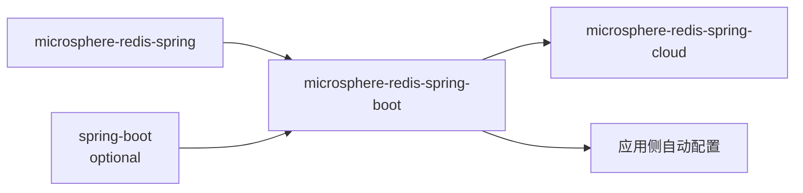
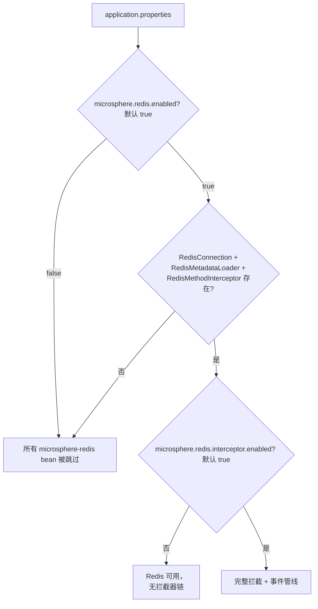

# microsphere-redis-spring-boot — 开发者文档

| 字段 | 值 |
|------|-----|
| 模块 | `microsphere-redis-spring-boot` |
| Git 分支 | `release`（0.2.x，最新发布 `0.2.14`） |
| 层次 | Spring Boot 适配（仅条件注解） |
| 依赖 | `microsphere-redis-spring`、`spring-boot-starter`（optional）、`spring-boot-actuator`（optional） |

## 模块位置与依赖



本模块刻意**不包含自己的自动配置**：拦截器通过 spring 模块的
`RedisInitializer` + `RedisInterceptorModuleInitializer`（spring.factories）装配，
在 Boot 下本就可以工作。Boot 模块补充的是一套可复用的 `@Conditional` 词汇表。

## 包结构

```
io.microsphere.redis.spring.boot.autoconfigure.condition
    ConditionalOnRedisEnabled.java
    ConditionalOnRedisInterceptorEnabled.java
    ConditionalOnRedisAvailable.java
```

## 源码解析

- `@ConditionalOnRedisEnabled`（ConditionalOnRedisEnabled.java:73）：
  `@ConditionalOnProperty(name = "microsphere.redis.enabled", matchIfMissing = true)` ——
  不显式关闭即开启。
- `@ConditionalOnRedisInterceptorEnabled`（ConditionalOnRedisInterceptorEnabled.java:72–73）：
  meta 标注 `@ConditionalOnRedisEnabled` **外加** `@ConditionalOnProperty`
  （`"microsphere.redis.interceptor.enabled"`，`matchIfMissing = true`）—— 两级门控：
  先 Redis 整体，再拦截功能。
- `@ConditionalOnRedisAvailable`（ConditionalOnRedisAvailable.java:57–58）：
  `@ConditionalOnRedisEnabled` + `@ConditionalOnClass(name = {RedisConnection, RedisMetadataLoader,
  RedisMethodInterceptor})` —— 即 spring-data-redis **和** microsphere-redis-spring 都必须在
  classpath 上。`@Target(TYPE)`，用于守护整个配置类。

`ConditionalOnRedisAvailable` 的三个类名检查使用字符串按名匹配，因此即便这些类缺失，本模块也能加载
（Boot 在类链接之前就求值条件）。

## 设计模式

| 模式 | 位置 | 说明 |
|------|------|------|
| 可组合条件（meta 注解） | 三个注解层层构建 | Available ⊃ Enabled；InterceptorEnabled ⊃ Enabled |
| classpath 特性探测 | `@ConditionalOnClass(name=...)` | 求值阶段不会 `NoClassDefFoundError` |

## 关键流程



## 测试策略

条件注解通过下游自动配置（cloud 模块测试、应用级 `@ConditionalOnRedisAvailable` 类）间接验证。
除注解元数据外没有更多可单测的行为。

## 扩展点

- 在你自己的 `@Configuration`/`@Bean` 上使用这三个条件之一，与框架的启用模型保持一致。

## 链接

- 用户文档：[../../user-guide/current/zh/microsphere-redis-spring-boot.md](../../../user-guide/current/zh/microsphere-redis-spring-boot.md)
- English: [../microsphere-redis-spring-boot.md](../microsphere-redis-spring-boot.md)
- 上一篇：[microsphere-redis-replicator-spring](./microsphere-redis-replicator-spring.md) · 下一篇：[microsphere-redis-spring-cloud](./microsphere-redis-spring-cloud.md)
