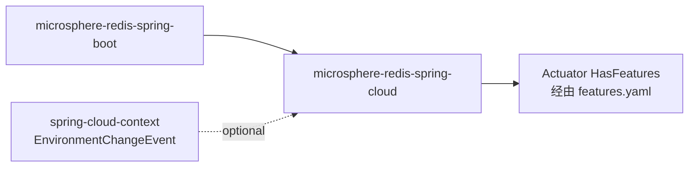
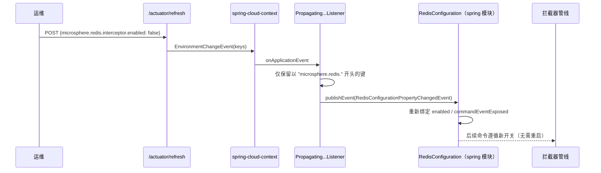

# microsphere-redis-spring-cloud — 开发者文档

| 字段 | 值 |
|------|-----|
| 模块 | `microsphere-redis-spring-cloud` |
| Git 分支 | `release`（0.2.x，最新发布 `0.2.14`） |
| 层次 | Spring Cloud 适配（运行期属性刷新 + 特性暴露） |
| 依赖 | `microsphere-redis-spring-boot`、`spring-cloud-commons`（optional）、`spring-cloud-context`（optional） |

## 模块位置与依赖



## 包结构

```
io.microsphere.redis.spring.cloud
    autoconfigure/RedisCloudAutoConfiguration.java
    event/PropagatingRedisConfigurationPropertyChangedEventApplicationListener.java
resources/META-INF/
    spring/org.springframework.boot.autoconfigure.AutoConfiguration.imports
    config/default/features.yaml
```

## 源码解析

### RedisCloudAutoConfiguration（RedisCloudAutoConfiguration.java:45）

通过 Boot 3 的 `AutoConfiguration.imports` 文件注册（仅一个条目）。其注解栈：

- `@ConditionalOnRedisAvailable`（第 45 行）—— 继承 boot 模块的"启用 + classpath"门控；
- `@ConditionalOnClass(name = "org.springframework.cloud.context.environment.EnvironmentChangeEvent")`
  （第 46 行）—— spring-cloud-context 缺失时整个模块关闭；
- `@AutoConfigureAfter(name = {...})`（第 49 行）—— 排在 Boot 的 Redis 自动配置**之后**，
  用字符串类名同时覆盖两个坐标时代（该类在 Boot 版本间*搬迁*过）：
  `o.s.b.autoconfigure.data.redis.RedisAutoConfiguration`（Boot [2.0, 4.0)）与
  `o.s.boot.data.redis.autoconfigure.DataRedisAutoConfiguration`（Boot [4.0,)）；
- `@Import(PropagatingRedisConfigurationPropertyChangedEventApplicationListener.class)`（第 53 行）。

### Propagating...ApplicationListener（…Listener.java:23）

`ApplicationListener<EnvironmentChangeEvent>`：在 cloud `/actuator/refresh`（或任何
`EnvironmentChangeEvent`）发生时，把变更的键过滤为以 `microsphere.redis.` 开头的键
（`filterSet(event.getKeys(), this::isRedisPropertyName)`，第 39 行），并以
`RedisConfigurationPropertyChangedEvent` 的形式重新发布到应用上下文（第 40 行）。
spring 模块的 `RedisConfiguration` 监听该事件并重新绑定启用/命令事件暴露开关 —— 因此
**拦截可以在运行期热切换，无需重启**。由于该前缀同样匹配 `microsphere.redis.replicator.*`，
replicator 的属性也走同一通道。

### features.yaml（META-INF/config/default/features.yaml）

microsphere-spring-cloud "HasFeatures" actuator 扩展的声明式输入：它列出抽象 API 面
（RedisTemplate 各变体、连接工厂、缓存管理器、按 Boot 版本区分的定制器 —— 含 3.1 的
`RedisConnectionDetails` 与 3.4 的 `LettuceClientOptionsBuilderCustomizer`），并把简单特性名
映射到具体 microsphere 类（全部序列化器、拦截器、`DynamicRedisConnectionFactory`、三个条件注解、
`SpringRedisMetadataLoader`）。

## 设计模式

| 模式 | 位置 | 说明 |
|------|------|------|
| 适配器/传播器 | listener：`EnvironmentChangeEvent` → `RedisConfigurationPropertyChangedEvent` | 把 cloud 词汇翻译成框架词汇 |
| 按名条件 | `@ConditionalOnClass(name=...)`、`@AutoConfigureAfter(name=...)` | 跨 Boot 大版本的类搬迁仍可用 |
| 声明式特性注册表 | features.yaml | 无需代码的 actuator 自省 |

## 关键流程



## 测试策略

- listener 可单测：发布混合键的 `EnvironmentChangeEvent`，断言发布的
  `RedisConfigurationPropertyChangedEvent` 只含 `microsphere.redis.*`。
- 自动配置顺序通过有无 spring-cloud-context 的上下文启动测试验证。

## 扩展点

- 任何 `microsphere.redis.` 前缀下的属性自动参与热刷新（前缀规则）。
- 扩展 features.yaml（或你自己模块的）以在 actuator 输出中暴露新组件。

## 链接

- 用户文档：[../../user-guide/current/zh/microsphere-redis-spring-cloud.md](../../../user-guide/current/zh/microsphere-redis-spring-cloud.md)
- English: [../microsphere-redis-spring-cloud.md](../microsphere-redis-spring-cloud.md)
- 上一篇：[microsphere-redis-spring-boot](./microsphere-redis-spring-boot.md) · 下一篇：[microsphere-redis-parent](./microsphere-redis-parent.md)
