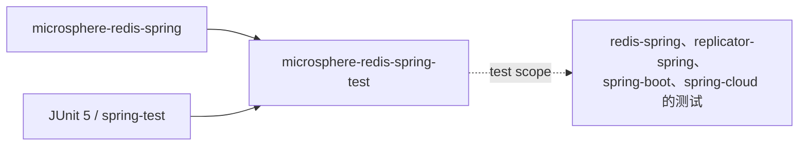

# microsphere-redis-spring-test — 开发者文档

| 字段 | 值 |
|------|-----|
| 模块 | `microsphere-redis-spring-test` |
| Git 分支 | `release`（0.2.x，最新发布 `0.2.14`） |
| 层次 | 测试支撑库（正式发布，以 `test` scope 被消费） |
| 依赖 | `microsphere-redis-spring`、JUnit 5、spring-test、spring-data-redis + Lettuce |

## 模块位置与依赖



本模块的存在使所有下游模块的集成测试共享同一套 Redis 装配，而非各自复制配置。
它是**正式发布**的构件，不是私有 test-jar。

## 包结构

```
io.microsphere.redis.spring.test
    AbstractRedisTest.java        # 默认禁用的基类 + 规范的 SET 夹具
    config/RedisConfig.java       # RedisTemplate / StringRedisTemplate / Lettuce 工厂 bean
```

## 源码解析

### `AbstractRedisTest`（AbstractRedisTest.java:45）

- 标注 `@Disabled`（第 43 行）—— 基类自身绝不在 CI 中运行；具体子类（如 `RedisTest`）
  在有可用 Redis 时解除禁用。
- `@SpringJUnitConfig(classes = RedisConfig.class)`（第 44 行）加载最小化上下文，不涉及应用服务器。
- 规范写命令夹具（第 47–51 行）：
  - `SET_METHOD` = `findMethod(RedisConnection.class, "set", byte[].class, byte[].class)` ——
    拦截器测试用来与元数据比对的精确 `Method` 对象；
  - `SET_METHOD_ARGS` = `["key".bytes, "value".bytes]`；
  - `SOURCE_BEAN_NAME_FOR_REDIS_TEMPLATE` = `"redisTemplate"`。
- `assertSet(redisTemplate, key, value)`（第 72 行）执行 `opsForValue().set` 后断言读回 ——
  子类测试用它验证拦截没有破坏正常语义。

### `RedisConfig`（config/RedisConfig.java）

三个 `static @Bean` 方法（static 使其无需提前实例化配置类即可注册）：
- `redisTemplate(...)` / `stringRedisTemplate(...)` —— 绑定到工厂的原始类型 Spring 模板；
- `redisConnectionFactory()` —— `LettuceConnectionFactory("127.0.0.1", 6379)` 并显式调用
  `afterPropertiesSet()` + `validateConnection()`，即 **Redis 未启动时上下文快速失败**。

## 设计模式

| 模式 | 位置 | 说明 |
|------|------|------|
| 模板方法（测试） | `AbstractRedisTest` 子类 | 共享夹具、各模块自行断言 |
| 静态工厂 bean | `RedisConfig` 的 `static @Bean` | 规避配置类实例化顺序问题 |
| 快速失败校验 | 工厂 bean 中的 `validateConnection()` | 环境配置错误在上下文加载时暴露，而非首条命令 |

## 关键流程

```mermaid
flowchart LR
    A[具体测试继承 AbstractRedisTest] --> B[@SpringJUnitConfig 加载 RedisConfig]
    B --> C[LettuceConnectionFactory 校验到 127.0.0.1:6379 的 TCP]
    C --> D[模板自动注入到测试]
    D --> E{本地 Redis 已启动？<br/>仓库 docker compose}
    E -- 是 --> F[测试执行 assertRedisTemplateSet / 拦截器断言]
    E -- 否 --> G[上下文失败：依赖未就绪]
```

## 测试策略

- `RedisTest`（src/test）演示了预期用法：启用它、运行 Redis（见仓库 `docker/` compose 文件），
  并同时断言命令透传与拦截效果。
- 下游模块复用 `SET_METHOD`/`SET_METHOD_ARGS`，使其拦截器断言与元数据仓库索引的是同一个
  `Method` identity。

## 扩展点

- 任何需要真实 Redis 的模块测试都继承 `AbstractRedisTest`。
- 更多夹具应添加在这里，而非在各模块测试源码中重复。

## 链接

- 用户文档：[../../user-guide/current/zh/microsphere-redis-spring-test.md](../../../user-guide/current/zh/microsphere-redis-spring-test.md)
- English: [../microsphere-redis-spring-test.md](../microsphere-redis-spring-test.md)
- 上一篇：[microsphere-redis-spring](./microsphere-redis-spring.md) · 下一篇：[microsphere-redis-replicator-spring](./microsphere-redis-replicator-spring.md)
