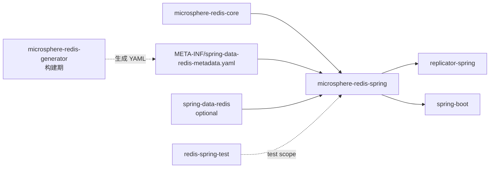
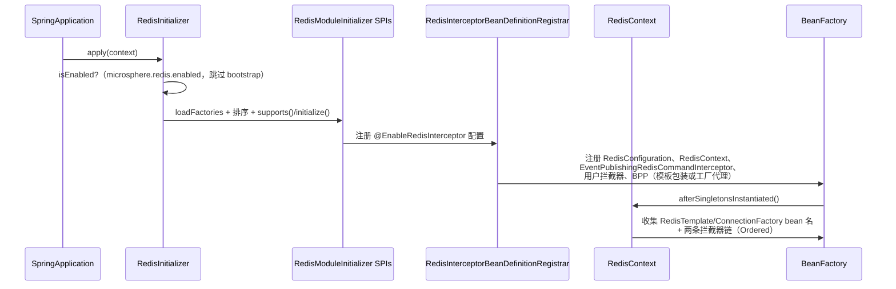
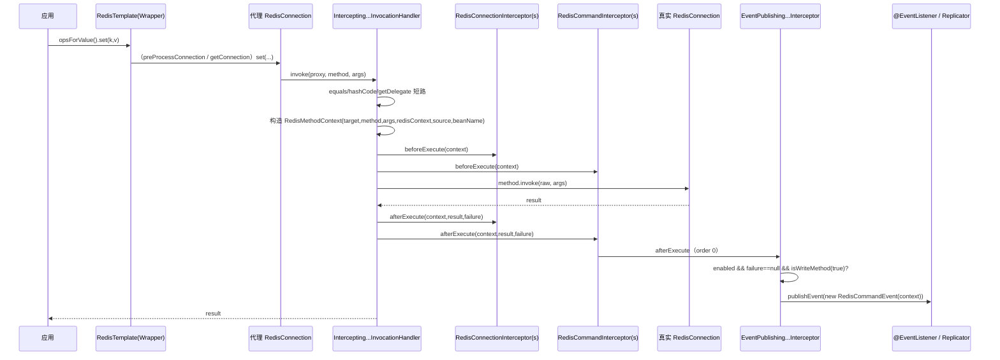

# microsphere-redis-spring — 开发者文档

| 字段 | 值 |
|------|-----|
| 模块 | `microsphere-redis-spring` |
| Git 分支 | `release`（0.2.x，最新发布 `0.2.14`） |
| 层次 | Spring 核心集成（框架的心脏） |
| 依赖 | `microsphere-redis-core`（compile）、`spring-data-redis`（optional）、`snakeyaml`、`jakarta.servlet-api`（optional）、`microsphere-spring-context`（optional） |

## 模块位置与依赖



本模块把静态命令元数据（由 generator 生产、由 core 建模）转化为**运行期拦截管线**：
每一次 `RedisConnection` 方法调用都会流经一个有序的拦截器链，成功的写命令会被重新发布为
`RedisCommandEvent`。

## 包结构

```
io.microsphere.redis.spring
    annotation/    # @EnableRedisConfiguration / @EnableRedisContext / @EnableRedisInterceptor + 注册器
    beans/         # RedisTemplate 包装器、BeanPostProcessor、WrapperProcessors
    config/        # RedisConfiguration（绑定 Environment 的运行期开关）
    connection/    # DynamicRedisConnectionFactory（+ web 清理监听器）
    context/       # RedisContext、RedisInitializer、RedisModuleInitializer SPI + 拦截器初始化器
    event/         # RedisOperationEvent、RedisCommandEvent、RedisConfigurationPropertyChangedEvent
    interceptor/   # InvocationHandler、RedisMethodContext、拦截器接口、事件发布器
    metadata/      # SpringRedisMetadataLoader、SpringRedisMetadataRepository
    serializer/    # 约 20 个类型化序列化器 + HoldingValueRedisSerializerWrapper + RedisCommandEventSerializer
    util/          # RedisConstants（属性键）、RedisSpringUtils、SpringRedisCommandUtils
```

## 源码解析

### annotation 包 —— 三个递进的 `@Enable*` 入口

- `@EnableRedisConfiguration` 仅注册 `RedisConfiguration` bean（开关 + 环境绑定）。
- `@EnableRedisContext` = `@EnableRedisConfiguration` + `@Import(RedisContextBeanDefinitionRegistrar.class)`，
  注册 `RedisContext` bean（`microsphere:redisContext`）。
- `@EnableRedisInterceptor` = `@EnableRedisContext` + `@Import(RedisInterceptorBeanDefinitionRegistrar.class)`。
  其属性决定整个装配：
  `wrapRedisTemplates()`（bean 名模式，默认取 `microsphere.redis.wrapped-redis-templates`，即 `*`）、
  `exposeCommandEvent()`（默认 `true`，可被 `microsphere.redis.command-event.exposed` 覆盖）、
  `sources()`（`BeanSource.BEAN_FACTORY` / `SPRING_FACTORIES` / `JAVA_SERVICE_PROVIDER` ——
  从哪些渠道发现用户拦截器）。
- `RedisInterceptorBeanDefinitionRegistrar.registerBeanDefinitions(...)`
  （RedisInterceptorBeanDefinitionRegistrar.java:78）读取上述属性，解析被包装模板的名字模式，
  然后（第 108 行）注册：`EventPublishingRedisCommandInterceptor` bean（若开启事件暴露）、
  从选定渠道发现的拦截器 bean，并根据 `wrapRedisTemplates` 是否指定模板名，二选一注册
  `RedisTemplateWrapperBeanPostProcessor`（显式模板名）或 `RedisConnectionFactoryProxyBeanPostProcessor`
  （工厂级代理）。

### context 包 —— 引导启动

- `RedisInitializer`（RedisInitializer.java:46）是通过 `spring.factories` 注册的
  `ApplicationContextInitializer`。其静态块触发 `SpringRedisMetadataRepository.init()`；
  `isEnabled(...)`（第 74 行）跳过 bootstrap 上下文并遵循 `microsphere.redis.enabled`；
  `initialize(...)`（第 55 行）通过 `SpringFactoriesLoader` 加载全部 `RedisModuleInitializer`，按
  `Ordered` 排序，逐个调用 `supports()` → `initialize()`。
- `RedisModuleInitializer` 是模块级 SPI：`supports(context, registry)` + `initialize(context, registry)`。
- `RedisInterceptorModuleInitializer` 实现该 SPI，是默认的免 `@Enable` 自动装配路径：它注册一个内部
  `@Configuration`，其上标注
  `@EnableRedisInterceptor(wrapRedisTemplates = DEFAULT_WRAP_REDIS_TEMPLATE_PLACEHOLDER)`
  （两个变体 —— 其中一个 `exposeCommandEvent = false` —— 按属性默认值选择）。
- `RedisContext`（RedisContext.java）同时实现 `SmartInitializingSingleton`、`ApplicationContextAware`、
  `BeanFactoryAware`、`BeanClassLoaderAware`。在 `afterSingletonsInstantiated()`（第 99 行）中收集：
  `RedisConfiguration`、全部 `RedisTemplate` bean 名、全部 `RedisConnectionFactory` bean 名以及两条
  拦截器链（`RedisConnectionInterceptor`、`RedisCommandInterceptor`，按 `Ordered` 排序）。
  `getRedisConfiguration()` 惰性回退到 `RedisConfiguration.get(beanFactory)`；`isEnabled()`（第 181 行）
  委托给配置对象。

### config 包

`RedisConfiguration`（RedisConfiguration.java）是 `RedisConstants` 中属性键的可变运行期视图
（`microsphere.redis.enabled`、`.interceptor.enabled`、`.command-event.exposed`、
`.wrapped-redis-templates`、`.fail-fast`）。它监听 `RedisConfigurationPropertyChangedEvent`
（实现 `ApplicationListener<...>`），使 spring-cloud 能在运行期翻转开关；静态定位方法
`get(beanFactory)`（第 90 行）被全模块使用。

### interceptor 包 —— 拦截管线

- `InterceptingRedisConnectionInvocationHandler`
  （InterceptingRedisConnectionInvocationHandler.java:52）—— 每个被代理连接的 JDK `InvocationHandler`。
  构造器（第 100 行）缓存两条拦截器链及布尔/计数快判字段。`invoke(...)`（第 117 行）：
  1. 短路 `equals`（代理同一性）、`hashCode`（`identityHashCode(proxy)`）、`getDelegate`
     （返回原始连接）—— 不创建上下文对象；
  2. 构造 `RedisMethodContext<RedisConnection>`（第 133 行）；
  3. `beforeExecute`（第 153 行）**先跑连接拦截器，再跑命令拦截器**；
  4. 反射调用原始连接；任何 `Throwable` 都经 `getCause()` 解包（第 142 行），
     调用方看到原始异常而非 `InvocationTargetException`；
  5. `finally` 阶段 `afterExecute`（第 172 行）携带 `(result, failure)` 再过两条链。
  拦截器故障绝不破坏业务调用：每个异常都被捕获并路由到
  `interceptor.handleError(context, before, result, failure, interceptionFailure)`（第 165、184 行）。
- `RedisMethodInterceptor<T>` —— 契约接口，继承 `Ordered`，全部为 default 方法：
  `beforeExecute(context)` / `beforeExecute(target, method, args, sourceBeanName)`、
  `afterExecute(context, result, failure)` / 全参版本，以及 `handleError(...)`。
  子接口绑定泛型：`RedisConnectionInterceptor extends RedisMethodInterceptor<RedisConnection>`、
  `RedisCommandInterceptor extends RedisMethodInterceptor<RedisCommands>`。
- `RedisMethodContext<T>`（RedisMethodContext.java）—— 交给每个拦截器的上下文对象（Context Object）。
  `ThreadLocal<RedisMethodContext<?>>`（第 85 行）通过静态 `set/get/clear`（第 517–537 行）暴露当前上下文，
  使序列化器和嵌套代码无需层层传参即可访问当前调用。它携带 target、method、args、source bean/name、
  活的 `RedisContext`、由环境派生的辅助方法（`getApplicationName`、`isEnabled`、`isCommandEventExposed`）、
  计时（`start()`/`stop()` 纳秒、`getDuration(TimeUnit)`）、属性 Map，以及写命令自省：
  `isWriteMethod()` 依据生成器元数据判定，`getParameters()`/`getParameter(name)` 把
  `ParameterMetadata` 绑定到运行期值。
- `EventPublishingRedisCommandInterceptor`（EventPublishingRedisCommandInterceptor.java:56）——
  内置命令拦截器，order 为 `0`。`afterExecute`（第 87 行）仅在事件暴露开启、调用成功
  （`failure == null`）且 `context.isWriteMethod(true)` 时发布 `RedisCommandEvent` ——
  即**读命令永不产生事件**。

### event 包

- `RedisOperationEvent extends ApplicationEvent` —— Redis 生命周期事件基类。
- `RedisCommandEvent`（event/RedisCommandEvent.java）—— 单次写命令的快照：method、接口名、方法名、
  参数类型/个数、args、应用名、source bean 名、可变的 `serializationVersion` 字节
  （由 `RedisCommandEventSerializer` 使用）以及执行时间戳（replicator 之后复用为 Kafka 记录时间戳）。
- `RedisConfigurationPropertyChangedEvent extends ApplicationContextEvent` —— 携带变更的属性名与
  `Environment`；由 `RedisConfiguration` 消费。

### beans 包 —— 连接如何被拦截

两种互斥策略：

1. **模板包装**（当 `wrapRedisTemplates` 指定模板时）：`RedisTemplateWrapperBeanPostProcessor`
   将 `RedisTemplate`/`StringRedisTemplate` 的 bean 定义替换为 `RedisTemplateWrapper<K,V>` /
   `StringRedisTemplateWrapper`。两者继承 Spring 原类并覆写
   `preProcessConnection(connection, existingConnection)`（RedisTemplateWrapper.java:76），
   借助 `RedisConnectionFactoryProxyBeanPostProcessor.newProxyRedisConnection(...)` 包装每个借出的连接，
   并由 `isEnabled()`（第 89 行）门控。这捕获了这些模板内部所有非 `RedisTemplate` 的代码路径。
2. **工厂代理**（默认，`wrapRedisTemplates` 为空）：`RedisConnectionFactoryProxyBeanPostProcessor`
   （RedisConnectionFactoryProxyBeanPostProcessor.java:74）将每个 `RedisConnectionFactory` bean 包进
   AOP `ProxyFactory`，其 advice（第 98 行）拦截 `getConnection()`：若 `RedisContext.isEnabled()`，
   返回的原始连接变成实现 `{RedisConnection, DelegatingWrapper}` 的 JDK 代理（第 76、128–133 行）。
   代理前的工厂被存为 `BeanDefinition` 属性，由 `getRawRedisConnectionFactory(beanFactory, beanName)`
   （第 148 行）取回 —— replicator 重放命令时需要用它以避免递归拦截。

`WrapperProcessors` + `HoldingValue{Redis,String}TemplateWrapperProcessor` 负责安装下节的 holding-value 序列化器。

### serializer 包 —— holding values 与线上格式

- `AbstractSerializer<T>` —— 模板方法：final 的 `serialize`/`deserialize` 簿记（字节长度计算、目标类型），
  内部调用抽象的 `doSerialize`/`doDeserialize`。
- `Serializers` —— 静态单例注册表（`BOOLEAN_SERIALIZER`、`RANGE_SERIALIZER`、`WEIGHTS_SERIALIZER`……），
  `DEFAULT_SERIALIZER` = Spring 的 `JdkSerializationRedisSerializer`、`STRING_SERIALIZER`；按目标类型查找。
- 之所以存在大量类型化序列化器，是因为 Redis 命令参数是*值对象*
  （`Expiration`、`Boundary`、`Range`、`GeoLocation`、`Point`、`SortParameters`、
  `RedisZSetCommands.Range/Weights`），并非 `Serializable` POJO。`RangeModel` 是 `Range` 的
  `Externalizable` 载体。
- `HoldingValueRedisSerializerWrapper` —— **原始字节 ↔ 对象的桥梁**：委派之前把
  `(object, bytes)` 成对写入 core 的 `ValueHolder` ThreadLocal。这使得拦截器在模板已把参数序列化成
  字节之后，仍能看到参数的*原始 Java 对象*。
- `RedisCommandEventSerializer` —— 复制场景的线上格式；以 `RedisSerializer` SPI 服务注册在
  `spring.factories`。通过 `serializationVersion` 字节做版本管理。

### metadata 包 —— 运行期元数据仓库

- `SpringRedisMetadataLoader implements RedisMetadataLoader`（注册于
  `META-INF/services/io.microsphere.redis.metadata.RedisMetadataLoader`）加载
  `META-INF/spring-data-redis-metadata.yaml` —— generator 模块在构建期写出的文件。
- `SpringRedisMetadataRepository`（SpringRedisMetadataRepository.java）是内存索引，在静态
  `initCache()` 中一次构建：
  - `redisCommandInterfacesCache`：`RedisConnection` 的全部 `Redis*Commands` 接口，按类名索引；
  - `redisCommandBindings`：接口名 → `Function<RedisConnection,Object>`（如 `keyCommands()`），
    用于定位命令子对象，使元数据可以对活代理做校验；
  - `methodInfoCache`（容量 4×1024）：三键 Map —— 按 `index`、按 `Method`、按
    `buildMethodId(method)` —— 支撑 `getMethodIndex(Method)`、`getRedisCommandMethod(int)`、
    `getRedisCommandMethod(interfaceName, methodName, parameterTypes...)` 以及写命令查询
    （`isWriteCommandMethod`、`getWriteParameterMetadataList`）。
  按紧凑 `int` 索引查找是 `RedisMethodContext.isWriteMethod()` 与 replicator 跨版本重放时使用的热路径。

### connection/dynamic 包

`DynamicRedisConnectionFactory` 实现 `RedisConnectionFactory` + `SmartInitializingSingleton`：
持有默认工厂 bean 名和一个**线程级目标覆盖**（`switchTarget(beanName)` / `clearTarget()` /
`getTargetBeanName()`），使应用代码可以把当前线程路由到另一个 Redis 实例（多租户/迁移场景）。
`DynamicRedisConnectionFactoryCleanerListener`（`ServletRequestListener`）在 `requestDestroyed` 时调用
`clearTarget()`，避免 ThreadLocal 在 servlet 容器中泄漏。

## 设计模式

| 模式 | 位置 | 说明 |
|------|------|------|
| JDK 动态代理 | `InterceptingRedisConnectionInvocationHandler`、`newProxyRedisConnection` | 仅接口代理 `RedisConnection` + `DelegatingWrapper` |
| 代理（AOP） | `RedisConnectionFactoryProxyBeanPostProcessor.doPostProcessAfterInitialization` | 对 `getConnection()` 的 `ProxyFactory` advice |
| 装饰器 | `RedisTemplateWrapper`、`StringRedisTemplateWrapper`、`HoldingValueRedisSerializerWrapper` | 子类/包装器保持 Spring 契约 |
| 拦截器链 | `RedisContext` 拦截器列表 + before/after 阶段 | 连接链在前、命令链在后，均按 `Ordered` |
| 上下文对象 | `RedisMethodContext`（及其 ThreadLocal 存取） | 一个对象承载 target/args/配置/计时/属性 |
| 观察者 | `EventPublishingRedisCommandInterceptor` → `RedisCommandEvent`；`RedisConfiguration` ← `RedisConfigurationPropertyChangedEvent` | Spring `ApplicationEvent` 机制 |
| 模板方法 | `AbstractSerializer.serialize/deserialize` → `doSerialize/doDeserialize` | |
| 注册表 / 索引 | `Serializers`、`SpringRedisMetadataRepository.methodInfoCache` | 三键 Map，int 索引热路径 |
| SPI | `RedisMetadataLoader`（services）、`RedisModuleInitializer`（spring.factories）、`RedisSerializer`（spring.factories） | |
| BeanDefinition 变更 | registrar + `RedisTemplateWrapperBeanPostProcessor` | 实例化前替换 bean 类 |
| 线程局部会话状态 | `DynamicRedisConnectionFactory.switchTarget`、`ValueHolder` | web 监听器按请求清理 |

## 关键流程

### 引导启动时序



### 一次 Redis 命令



### Holding-value 还原（序列化后仍可见原始对象）

```mermaid
flowchart LR
    A[模板把参数序列化为字节] --> B[HoldingValueRedisSerializerWrapper.serialize]
    B --> C[ValueHolder ThreadLocal：双向写入 object ↔ bytes]
    B --> D[委派给真实序列化器]
    E[拦截器读取 context args] --> F{参数是 byte[]?}
    F -- 是 --> G[ValueHolder.getValue(bytes) → 原始对象]
    F -- 否 --> H[直接使用对象]
```

## 测试策略

- 单元/组件测试位于 `microsphere-redis-spring/src/test/java`，如 `@EnableRedis*` 注解测试
  （`EnableRedisInterceptorTest`、`RedisContextTest`、`RedisConfigurationTest`）与序列化器往返测试。
- 集成测试借助 `microsphere-redis-spring-test`（`AbstractRedisTest`、`RedisConfig`）对本地 Redis 运行
  （仓库 `docker/` compose 文件）；`SET_METHOD`/`SET_METHOD_ARGS` 常量让拦截器测试有一个规范的写命令可断言。
- 元数据正确性在构建期而非测试期强制：generator 在 YAML 出厂前对照 `META-INF/redis-commands` 校验全部 index/id。

## 扩展点

- 实现 `RedisCommandInterceptor` / `RedisConnectionInterceptor`，由 registrar 按选定渠道发现
  （`BeanSource.BEAN_FACTORY`、`SPRING_FACTORIES` 或 `JAVA_SERVICE_PROVIDER`）。
- 在 `spring.factories` 注册自己的 `RedisModuleInitializer` 以添加模块级 bean。
- 实现 `RedisMetadataLoader`（services 文件）贡献元数据 —— 由 `RedisMetadata.merge` 合并。
- 用 `@EventListener` 监听 `RedisCommandEvent`；结合 `event.getArg(i)` 与 `ValueHolder` 还原原始对象。
- 通过 `RedisSerializer` SPI 或 `Serializers` 查找插入自定义序列化器。

## 链接

- 用户文档：[../../user-guide/current/zh/microsphere-redis-spring.md](../../../user-guide/current/zh/microsphere-redis-spring.md)
- English: [../microsphere-redis-spring.md](../microsphere-redis-spring.md)
- 上一篇：[microsphere-redis-generator](./microsphere-redis-generator.md) · 下一篇：[microsphere-redis-spring-test](./microsphere-redis-spring-test.md)
