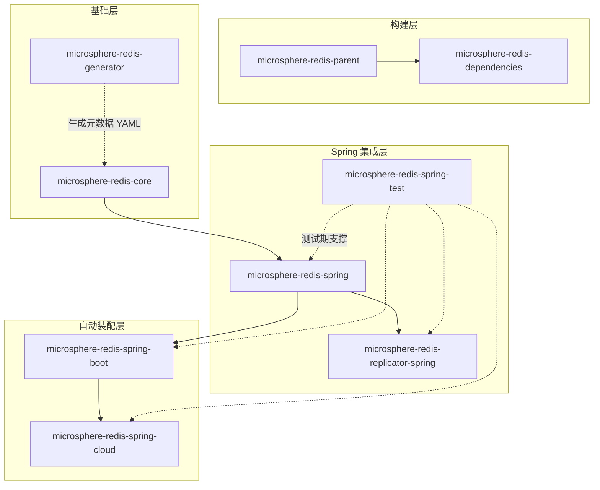

# 开发者文档

[English](../README.md) | 中文

开发者文档面向**贡献者与维护者**。每个 Maven 模块都有独立文档，内容包括：

- **架构设计** —— 模块分层、包结构与扩展点
- **源码分析** —— 对重要实现机制的逐类解析
- **设计模式** —— SPI、代理（Proxy）、包装/装饰器（Wrapper/Decorator）、模板方法、观察者、注册表、工厂等
- **流程图** —— 复杂流程的 Mermaid 图（拦截链、事件发布、Kafka 复制管线等）
- **模块依赖图** —— Maven 模块间依赖关系的 Mermaid 流程图

## 选择发布线

| 发布线 | 文档目录 | Git 分支 | 版本 | Spring Data Redis | 典型技术栈 |
|--------|----------|----------|------|-------------------|------------|
| 当前版 | [`current/`](../current/) | `release`     | 0.2.x（`0.2.14`） | 3.0.0 – 3.5.x | Spring Boot 3.x，Java 17+ |
| 1.x 维护线 | [`1.x/`](../1.x/)     | `release-1.x` | 0.1.x（`0.1.14`） | 2.1.0 – 2.7.x | Spring Boot 2.x，Java 8+ |

## 模块文档（current / 0.2.x）

- [microsphere-redis-parent](../current/microsphere-redis-parent.md)
- [microsphere-redis-dependencies](../current/microsphere-redis-dependencies.md)
- [microsphere-redis-core](../current/microsphere-redis-core.md)
- [microsphere-redis-generator](../current/microsphere-redis-generator.md)
- [microsphere-redis-spring](../current/microsphere-redis-spring.md)
- [microsphere-redis-spring-test](../current/microsphere-redis-spring-test.md)
- [microsphere-redis-replicator-spring](../current/microsphere-redis-replicator-spring.md)
- [microsphere-redis-spring-boot](../current/microsphere-redis-spring-boot.md)
- [microsphere-redis-spring-cloud](../current/microsphere-redis-spring-cloud.md)

中文译文与英文文档同名，位于各分支目录的 `zh/` 子目录中。

## 模块文档（1.x / 0.1.x）

同样九个模块的文档位于 [`1.x/`](../1.x/) 目录（其中文位于 `1.x/zh/`）。

## 总体架构

每条依赖边的细节解析见各模块的开发者文档。
