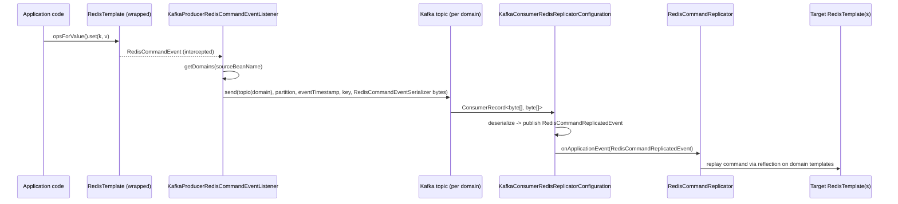

# microsphere-redis-replicator-spring

| Field | Value |
|-------|-------|
| Module | `microsphere-redis-replicator-spring` |
| Git branch | `release` (0.2.x line) |
| Latest release | `0.2.14` |
| Maven coordinates | `io.github.microsphere-projects:microsphere-redis-replicator-spring` |
| Compatibility | Spring Data Redis 3.0.0 – 3.5.x, Spring Kafka (Boot 3.x line), JDK 17+ |
| Key dependencies | `microsphere-redis-spring` (compile), `spring-kafka` (optional) |

## Overview

This module replicates **write commands** executed in one Spring application onto other Redis clusters by piping
intercepted `RedisCommandEvent`s through **Kafka**:

- The **producer** side observes `RedisCommandEvent`s, groups them by configurable *domains*, serializes them with
  `RedisCommandEventSerializer` and sends them to one Kafka topic per domain.
- The **consumer** side listens on those topics, deserializes the events and re-executes (`replays`) the commands
  against the local `RedisTemplate`s of that domain.

Typical use cases: multi-datacenter cache fan-out, cross-cluster active/active synchronization, feeding a
standby cluster from an authoritative one.

## Installation

```xml
<dependency>
    <groupId>io.github.microsphere-projects</groupId>
    <artifactId>microsphere-redis-replicator-spring</artifactId>
</dependency>

<!-- bring your own Kafka stack -->
<dependency>
    <groupId>org.springframework.kafka</groupId>
    <artifactId>spring-kafka</artifactId>
</dependency>
```

Activation is property-driven (the module bootstraps itself through the `RedisModuleInitializer` mechanism once
`microsphere-redis.enabled=true` and `microsphere.redis.replicator.enabled=true`):

```properties
microsphere.redis.enabled=true
microsphere.redis.replicator.enabled=true
microsphere.redis.replicator.domains.default.redis-templates=redisTemplate,stringRedisTemplate
spring.kafka.bootstrap-servers=127.0.0.1:9092
```

## Configuration Reference

### Core (`RedisReplicatorConfiguration`)

| Property | Default | Meaning |
|----------|---------|---------|
| `microsphere.redis.replicator.enabled` | `true` | enable replication |
| `microsphere.redis.replicator.consumer.enabled` | `false` | enable the replay consumer in this app (producer-only by default) |
| `microsphere.redis.replicator.domains` | `default` | comma-separated domain names |
| `microsphere.redis.replicator.domains.{domain}.redis-templates` | — | template bean names belonging to a domain (commands from these templates are tagged to that domain) |

Bean names used internally: `microsphere:redisReplicatorConfiguration`, `microsphere:redisCommandReplicator`.

Helper API: `RedisReplicatorConfiguration.isRedisReplicatorEnabled(Environment)`,
`isRedisReplicatorConsumerEnabled(Environment)`, `getDomains(sourceBeanName)`, `get(BeanFactory)`.

### Kafka (`KafkaRedisReplicatorConfiguration`)

| Property | Default | Meaning |
|----------|---------|---------|
| `microsphere.redis.replicator.kafka.bootstrap.servers` | `${spring.kafka.bootstrap-servers:127.0.0.1:9092}` | Kafka brokers (falls back to Spring's own property) |
| `microsphere.redis.replicator.kafka.topic-prefix` | `redis-replicator-event-topic-` | topic per domain: `topicPrefix + domain` |

### Kafka consumer extras

| Property | Default |
|----------|---------|
| `microsphere.redis.replicator.kafka.consumer.enabled` | `true` (only effective when the replicator consumer is enabled) |
| `microsphere.redis.replicator.kafka.listener.poll-timeout` | `10000` |
| `microsphere.redis.replicator.kafka.listener.concurrency` | `1` (effective concurrency = max(topic count, value)) |

Consumer group id is prefixed with `Redis-Replicator-`.

## How It Works (Producer → Topic → Consumer)



Ordering: a `RedisComandEventPartitioner` bean may pin events to partitions —

```java
public interface RedisComandEventPartitioner {
    Integer partition(RedisCommandEvent event); // null = let Kafka decide
}
```

so that all commands for the same key (or any chosen dimension) land in one partition and are replayed in order.
Events are sent asynchronously on an executor and keep the original `event.getTimestamp()` as Kafka timestamp.

## Public API Summary

| Class | Role |
|-------|------|
| `RedisReplicatorInitializer` (`implements RedisModuleInitializer`) | registers the replicator beans at startup, registers consumer components only when the consumer is enabled |
| `RedisReplicatorConfiguration` | property-bound config; reacts to `RedisConfigurationPropertyChangedEvent` for runtime refresh |
| `KafkaRedisReplicatorConfiguration` | base config: broker list, topic prefix, `createTopic(domain)`, `getDomain(topic)` |
| `KafkaProducerRedisReplicatorConfiguration` | creates the dedicated `KafkaTemplate<byte[], byte[]>` producer; lifecycle `afterPropertiesSet`/`destroy` |
| `KafkaProducerRedisCommandEventListener` | `ApplicationListener<RedisCommandEvent>`: routes events to domain topics (async, with completion logging) |
| `RedisComandEventPartitioner` | SPI for partition assignment |
| `KafkaConsumerRedisReplicatorConfiguration` | `KafkaMessageListenerContainer` bean over all domain topics; each record is deserialized and published as `RedisCommandReplicatedEvent` |
| `RedisCommandReplicator` | `ApplicationListener<RedisCommandReplicatedEvent>` — replays the command on the domain's template/connection |
| `RedisCommandReplicatedEvent` | event carrying the deserialized `RedisCommandEvent` plus target `domain` and source `RedisReplicatorConfiguration` |

## Code Examples

### Declaring replication domains (from `src/test/resources/META-INF/test-redis-replicator.properties`)

```properties
microsphere.redis.replicator.domains = default,test,fixed,duplicated
microsphere.redis.replicator.domains.default.redis-templates = defaultRedisTemplate, defaultStringRedisTemplate
microsphere.redis.replicator.domains.test.redis-templates = testRedisTemplate , testStringRedisTemplate
microsphere.redis.replicator.domains.fixed.redis-templates = defaultRedisTemplate, defaultStringRedisTemplate, testRedisTemplate , testStringRedisTemplate
microsphere.redis.replicator.domains.duplicated.redis-templates = defaultRedisTemplate, defaultStringRedisTemplate, defaultRedisTemplate
```

A template listed in several domains (e.g. `defaultRedisTemplate`) fans its commands out to **all** those domains.

### Enabling the replicator in a test context (from `RedisCommandReplicatorIntegrationTest`)

```java
@TestPropertySource(properties = {
        "microsphere.redis.enabled=true"
})
class RedisCommandReplicatorIntegrationTest extends AbstractRedisReplicatorTest {
    // writes through the replicated templates are replayed on the paired templates
}
```

### Test configuration layout (from `config/DefaultRedisReplicationConfig` and `config/FullRedisReplicationConfig`)

Pair one "source" template with one or more "replica" templates in the same context; the domain properties bind
them; each write through the source template ends up executed on the replicas via the Kafka round-trip.

## Version & Compatibility

| Item | Value |
|------|-------|
| Version line | 0.2.x (`release` branch), latest release **0.2.14** |
| Spring Data Redis | 3.0.0 – 3.5.x |
| Kafka | via `spring-kafka` (Boot 3.x managed line); any Kafka 2.6+/3.x broker |
| Serialization | `RedisCommandEventSerializer` stamps a `serializationVersion` byte — producer and consumer must run the same framework line |
| Legacy | 0.1.x line for Spring Boot 2 stacks: [../../1.x/microsphere-redis-replicator-spring.md](../1.x/microsphere-redis-replicator-spring.md) |

Tests require a live Redis (`127.0.0.1:6379`) and Kafka (`127.0.0.1:9092`) — the repository `docker/` compose
files provide both for CI runs.

## Related Modules

- [microsphere-redis-spring](./microsphere-redis-spring.md) — produces the `RedisCommandEvent`s this module ships
- [microsphere-redis-spring-boot](./microsphere-redis-spring-boot.md) — conditions for gating replicator auto-config
- Developer guide: [../../developer-guide/current/microsphere-redis-replicator-spring.md](../../developer-guide/current/microsphere-redis-replicator-spring.md)
