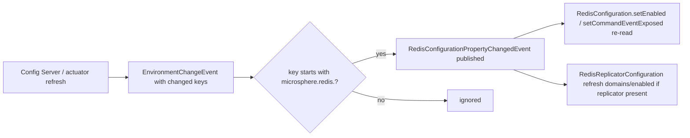

# microsphere-redis-spring-cloud

| Field | Value |
|-------|-------|
| Module | `microsphere-redis-spring-cloud` |
| Git branch | `release` (0.2.x line) |
| Latest release | `0.2.14` |
| Maven coordinates | `io.github.microsphere-projects:microsphere-redis-spring-cloud` |
| Compatibility | Spring Cloud 2022+ (`spring-cloud-context`), Spring Boot 3.x, Spring Data Redis 3.0.0 – 3.5.x, JDK 17+ |
| Key dependencies | `microsphere-redis-spring-boot` (compile), `spring-cloud-commons` / `spring-cloud-context` (optional) |

## Overview

This module bridges **Spring Cloud externalized configuration** with Microsphere Redis: when a config refresh
(`/actuator/refresh`, Bus events, Vault/Consul updates) changes any `microsphere.redis.*` property, the module turns
the resulting `EnvironmentChangeEvent` into a `RedisConfigurationPropertyChangedEvent` so that `RedisConfiguration`
(and `RedisReplicatorConfiguration` when present) re-reads its properties **at runtime, without restart**.

## Installation

```xml
<dependency>
    <groupId>io.github.microsphere-projects</groupId>
    <artifactId>microsphere-redis-spring-cloud</artifactId>
</dependency>
```

The auto-configuration `RedisCloudAutoConfiguration` registers itself via the standard Spring Boot imports file and
activates only when:

- `@ConditionalOnRedisAvailable` holds (Redis enabled + required classes present), and
- `org.springframework.cloud.context.environment.EnvironmentChangeEvent` is on the classpath.

It is ordered `@AutoConfigureAfter` Boot's Redis auto-configuration (both the classic
`RedisAutoConfiguration` and the Boot 4 `DataRedisAutoConfiguration` naming).

## API Reference

### RedisCloudAutoConfiguration

```java
@ConditionalOnRedisAvailable
@ConditionalOnClass(name = "org.springframework.cloud.context.environment.EnvironmentChangeEvent")
@AutoConfigureAfter(name = {
        "org.springframework.boot.autoconfigure.data.redis.RedisAutoConfiguration",
        "org.springframework.boot.data.redis.autoconfigure.DataRedisAutoConfiguration"
})
@Import(PropagatingRedisConfigurationPropertyChangedEventApplicationListener.class)
public class RedisCloudAutoConfiguration {}
```

### PropagatingRedisConfigurationPropertyChangedEventApplicationListener

```java
public class PropagatingRedisConfigurationPropertyChangedEventApplicationListener
        implements ApplicationListener<EnvironmentChangeEvent> {

    public PropagatingRedisConfigurationPropertyChangedEventApplicationListener(ConfigurableApplicationContext context);

    @Override
    public void onApplicationEvent(EnvironmentChangeEvent event);
    // filters event.getKeys() to names starting with "microsphere.redis." and
    // publishes RedisConfigurationPropertyChangedEvent(context, matchedKeys)
}
```

## Flow



## Code Example

Change behavior at runtime with a single refresh:

```properties
# bootstrap (config server / application.yml)
microsphere.redis.command-event.exposed=true
```

```bash
# after editing the remote property to `false`
curl -X POST http://localhost:8080/actuator/refresh
```

The listener republishes the change, `RedisConfiguration` reloads it, and from then on `RedisCommandEvent`s stop
being emitted — no restart required (verified by `RedisCloudAutoConfigurationIntegrationTest` and
`PropagatingRedisConfigurationPropertyChangedEventApplicationListenerTest`).

## Version & Compatibility

| Item | Value |
|------|-------|
| Version line | 0.2.x (`release` branch), latest release **0.2.14** |
| Spring Cloud | any release train providing `spring-cloud-context` `EnvironmentChangeEvent` (2022.x – 2025.x tested against Boot 3.x) |
| Spring Boot | 3.x; the `@AutoConfigureAfter` name list already covers Boot 4's Redis auto-config rename |
| JDK | 17+ |
| Legacy | 0.1.x line for Spring Boot 2 / Spring Cloud 2021-and-earlier stacks: [../../1.x/microsphere-redis-spring-cloud.md](../1.x/microsphere-redis-spring-cloud.md) |

## Related Modules

- [microsphere-redis-spring-boot](./microsphere-redis-spring-boot.md) — the conditions this module builds on
- [microsphere-redis-spring](./microsphere-redis-spring.md) — `RedisConfiguration` and the property keys
- Developer guide: [../../developer-guide/current/microsphere-redis-spring-cloud.md](../../developer-guide/current/microsphere-redis-spring-cloud.md)
