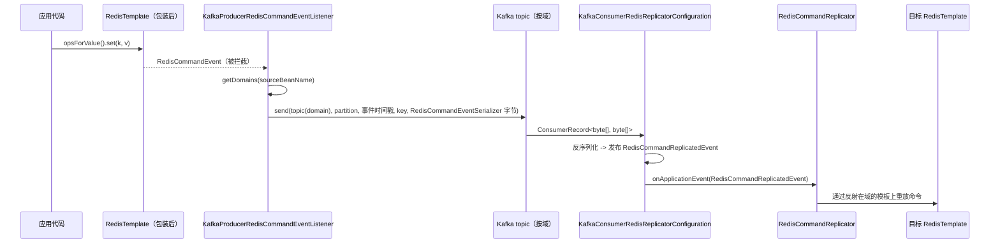

# microsphere-redis-replicator-spring

| 字段 | 值 |
|------|-----|
| 模块 | `microsphere-redis-replicator-spring` |
| Git 分支 | `release`（0.2.x 版本线） |
| 最新发布版本 | `0.2.14` |
| Maven 坐标 | `io.github.microsphere-projects:microsphere-redis-replicator-spring` |
| 兼容性 | Spring Data Redis 3.0.0 – 3.5.x、Spring Kafka（Boot 3.x 版本线）、JDK 17+ |
| 关键依赖 | `microsphere-redis-spring`（compile）、`spring-kafka`（optional） |

## 概述

本模块把被拦截的 `RedisCommandEvent` 经由 **Kafka** 传输，将某个 Spring 应用执行的**写命令**复制到其它
Redis 集群：

- **生产者**侧观察 `RedisCommandEvent`，按可配置的*域（domain）*分组，使用 `RedisCommandEventSerializer`
  序列化后发送到每个域对应的 Kafka topic。
- **消费者**侧监听这些 topic，反序列化事件，并在该域的本地 `RedisTemplate` 上重新执行（replay）命令。

典型场景：多机房缓存扇出、跨集群 active/active 同步、为主集群配备用集群。

## 安装

```xml
<dependency>
    <groupId>io.github.microsphere-projects</groupId>
    <artifactId>microsphere-redis-replicator-spring</artifactId>
</dependency>

<!-- Kafka 技术栈需要自带 -->
<dependency>
    <groupId>org.springframework.kafka</groupId>
    <artifactId>spring-kafka</artifactId>
</dependency>
```

启用完全由属性驱动（当 `microsphere.redis.enabled=true` 且 `microsphere.redis.replicator.enabled=true` 时，
模块通过 `RedisModuleInitializer` 机制自动装配）：

```properties
microsphere.redis.enabled=true
microsphere.redis.replicator.enabled=true
microsphere.redis.replicator.domains.default.redis-templates=redisTemplate,stringRedisTemplate
spring.kafka.bootstrap-servers=127.0.0.1:9092
```

## 配置参考

### 核心配置（`RedisReplicatorConfiguration`）

| 属性 | 默认值 | 含义 |
|------|--------|------|
| `microsphere.redis.replicator.enabled` | `true` | 启用复制 |
| `microsphere.redis.replicator.consumer.enabled` | `false` | 在本应用启用重放消费者（默认仅生产者） |
| `microsphere.redis.replicator.domains` | `default` | 逗号分隔的域名列表 |
| `microsphere.redis.replicator.domains.{domain}.redis-templates` | — | 属于该域的模板 bean 名（来自这些模板的命令会被打上该域标记） |

内部使用的 bean 名：`microsphere:redisReplicatorConfiguration`、`microsphere:redisCommandReplicator`。

辅助 API：`RedisReplicatorConfiguration.isRedisReplicatorEnabled(Environment)`、
`isRedisReplicatorConsumerEnabled(Environment)`、`getDomains(sourceBeanName)`、`get(BeanFactory)`。

### Kafka 配置（`KafkaRedisReplicatorConfiguration`）

| 属性 | 默认值 | 含义 |
|------|--------|------|
| `microsphere.redis.replicator.kafka.bootstrap.servers` | `${spring.kafka.bootstrap-servers:127.0.0.1:9092}` | Kafka 地址（回退到 Spring 自身属性） |
| `microsphere.redis.replicator.kafka.topic-prefix` | `redis-replicator-event-topic-` | 每域一个 topic：`topicPrefix + domain` |

### Kafka 消费者附加属性

| 属性 | 默认值 |
|------|--------|
| `microsphere.redis.replicator.kafka.consumer.enabled` | `true`（仅在复制消费者总开关打开时生效） |
| `microsphere.redis.replicator.kafka.listener.poll-timeout` | `10000` |
| `microsphere.redis.replicator.kafka.listener.concurrency` | `1`（实际并发 = max(topic 数量, 该值)） |

消费者组 id 以 `Redis-Replicator-` 为前缀。

## 工作原理（生产者 → Topic → 消费者）



顺序性：可通过 `RedisComandEventPartitioner` bean 将事件钉到指定分区——

```java
public interface RedisComandEventPartitioner {
    Integer partition(RedisCommandEvent event); // 返回 null 表示交给 Kafka 计算
}
```

使同一 key（或任意选择维度）的所有命令落入同一分区从而按序重放。事件在 executor 上异步发送，并以原始
`event.getTimestamp()` 作为 Kafka 时间戳。

## 公共 API 摘要

| 类 | 职责 |
|----|------|
| `RedisReplicatorInitializer`（实现 `RedisModuleInitializer`） | 启动时注册复制相关 bean；仅在消费者开启时注册消费组件 |
| `RedisReplicatorConfiguration` | 属性绑定的配置对象；响应 `RedisConfigurationPropertyChangedEvent` 实现运行期刷新 |
| `KafkaRedisReplicatorConfiguration` | 基础配置：broker 列表、topic 前缀、`createTopic(domain)`、`getDomain(topic)` |
| `KafkaProducerRedisReplicatorConfiguration` | 创建专用 `KafkaTemplate<byte[], byte[]>` 生产者；生命周期 `afterPropertiesSet`/`destroy` |
| `KafkaProducerRedisCommandEventListener` | `ApplicationListener<RedisCommandEvent>`：把事件路由到各域 topic（异步、带成败日志） |
| `RedisComandEventPartitioner` | 分区分配 SPI |
| `KafkaConsumerRedisReplicatorConfiguration` | 在所有域 topic 上创建 `KafkaMessageListenerContainer` bean；每条记录反序列化后发布为 `RedisCommandReplicatedEvent` |
| `RedisCommandReplicator` | `ApplicationListener<RedisCommandReplicatedEvent>`——在域的模板/连接上重放命令 |
| `RedisCommandReplicatedEvent` | 携带反序列化后的 `RedisCommandEvent`、目标 `domain` 及来源 `RedisReplicatorConfiguration` |

## 代码示例

### 声明复制域（来自 `src/test/resources/META-INF/test-redis-replicator.properties`）

```properties
microsphere.redis.replicator.domains = default,test,fixed,duplicated
microsphere.redis.replicator.domains.default.redis-templates = defaultRedisTemplate, defaultStringRedisTemplate
microsphere.redis.replicator.domains.test.redis-templates = testRedisTemplate , testStringRedisTemplate
microsphere.redis.replicator.domains.fixed.redis-templates = defaultRedisTemplate, defaultStringRedisTemplate, testRedisTemplate , testStringRedisTemplate
microsphere.redis.replicator.domains.duplicated.redis-templates = defaultRedisTemplate, defaultStringRedisTemplate, defaultRedisTemplate
```

被列入多个域的模板（如 `defaultRedisTemplate`）会把命令扇出到**所有**这些域。

### 在测试上下文中启用复制（来自 `RedisCommandReplicatorIntegrationTest`）

```java
@TestPropertySource(properties = {
        "microsphere.redis.enabled=true"
})
class RedisCommandReplicatorIntegrationTest extends AbstractRedisReplicatorTest {
    // 经过被复制模板的写命令会被重放到配对模板上
}
```

### 测试配置布局（来自 `config/DefaultRedisReplicationConfig` 与 `config/FullRedisReplicationConfig`）

在同一上下文中把一个"源"模板与一个或多个"副本"模板配对；由域属性绑定；源模板上的每次写入都会经 Kafka
往返后在副本上执行。

## 版本与兼容性

| 项目 | 值 |
|------|-----|
| 版本线 | 0.2.x（`release` 分支），最新发布 **0.2.14** |
| Spring Data Redis | 3.0.0 – 3.5.x |
| Kafka | 经 `spring-kafka`（Boot 3.x 托管版本线）；兼容任意 Kafka 2.6+/3.x broker |
| 序列化 | `RedisCommandEventSerializer` 会写入 `serializationVersion` 字节——生产者与消费者必须运行同一框架版本线 |
| 遗留线 | Spring Boot 2 技术栈使用 0.1.x：[../../1.x/microsphere-redis-replicator-spring.md](../../1.x/microsphere-redis-replicator-spring.md) |

测试需要真实 Redis（`127.0.0.1:6379`）与 Kafka（`127.0.0.1:9092`）——仓库 `docker/` compose 文件为 CI 提供两者。

## 相关模块

- [microsphere-redis-spring](./microsphere-redis-spring.md) —— 产生本模块传输所需 `RedisCommandEvent` 的模块
- [microsphere-redis-spring-boot](./microsphere-redis-spring-boot.md) —— 用于门控复制自动配置的条件注解
- 开发者文档：[../../developer-guide/current/microsphere-redis-replicator-spring.md](../../../developer-guide/current/microsphere-redis-replicator-spring.md)
