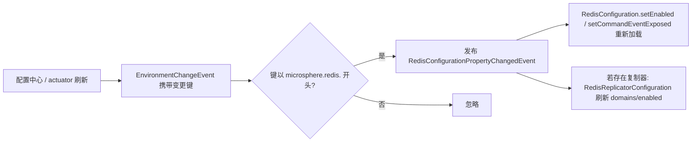

# microsphere-redis-spring-cloud

| 字段 | 值 |
|------|-----|
| 模块 | `microsphere-redis-spring-cloud` |
| Git 分支 | `release`（0.2.x 版本线） |
| 最新发布版本 | `0.2.14` |
| Maven 坐标 | `io.github.microsphere-projects:microsphere-redis-spring-cloud` |
| 兼容性 | Spring Cloud 2022+（`spring-cloud-context`）、Spring Boot 3.x、Spring Data Redis 3.0.0 – 3.5.x、JDK 17+ |
| 关键依赖 | `microsphere-redis-spring-boot`（compile）、`spring-cloud-commons` / `spring-cloud-context`（optional） |

## 概述

本模块把 **Spring Cloud 外部化配置**与 Microsphere Redis 连接起来：当配置刷新（`/actuator/refresh`、Bus 事件、
Vault/Consul 更新）改变了任意 `microsphere.redis.*` 属性时，模块将随之产生的 `EnvironmentChangeEvent` 转换为
`RedisConfigurationPropertyChangedEvent`，使 `RedisConfiguration`（以及存在时的
`RedisReplicatorConfiguration`）**无需重启即可在运行期**重新读取属性。

## 安装

```xml
<dependency>
    <groupId>io.github.microsphere-projects</groupId>
    <artifactId>microsphere-redis-spring-cloud</artifactId>
</dependency>
```

自动配置类 `RedisCloudAutoConfiguration` 通过标准 Spring Boot imports 文件注册，仅在以下条件满足时激活：

- `@ConditionalOnRedisAvailable` 成立（Redis 已启用且必需类在类路径上）；
- 类路径存在 `org.springframework.cloud.context.environment.EnvironmentChangeEvent`。

其顺序为 `@AutoConfigureAfter` Boot 的 Redis 自动配置（同时覆盖经典 `RedisAutoConfiguration` 与
Boot 4 的 `DataRedisAutoConfiguration` 命名）。

## API 说明

### RedisCloudAutoConfiguration

```java
@ConditionalOnRedisAvailable
@ConditionalOnClass(name = "org.springframework.cloud.context.environment.EnvironmentChangeEvent")
@AutoConfigureAfter(name = {
        "org.springframework.boot.autoconfigure.data.redis.RedisAutoConfiguration",
        "org.springframework.boot.data.redis.autoconfigure.DataRedisAutoConfiguration"
})
@Import(PropagatingRedisConfigurationPropertyChangedEventApplicationListener.class)
public class RedisCloudAutoConfiguration {}
```

### PropagatingRedisConfigurationPropertyChangedEventApplicationListener

```java
public class PropagatingRedisConfigurationPropertyChangedEventApplicationListener
        implements ApplicationListener<EnvironmentChangeEvent> {

    public PropagatingRedisConfigurationPropertyChangedEventApplicationListener(ConfigurableApplicationContext context);

    @Override
    public void onApplicationEvent(EnvironmentChangeEvent event);
    // 过滤 event.getKeys() 中以 "microsphere.redis." 开头的键，
    // 并发布 RedisConfigurationPropertyChangedEvent(context, matchedKeys)
}
```

## 流程



## 代码示例

一次刷新即可改变运行期行为：

```properties
# bootstrap（配置中心 / application.yml）
microsphere.redis.command-event.exposed=true
```

```bash
# 将远端属性改为 false 之后
curl -X POST http://localhost:8080/actuator/refresh
```

监听器重新发布变更，`RedisConfiguration` 重新加载，此后 `RedisCommandEvent` 不再发出——无需重启
（由 `RedisCloudAutoConfigurationIntegrationTest` 与
`PropagatingRedisConfigurationPropertyChangedEventApplicationListenerTest` 验证）。

## 版本与兼容性

| 项目 | 值 |
|------|-----|
| 版本线 | 0.2.x（`release` 分支），最新发布 **0.2.14** |
| Spring Cloud | 提供 `spring-cloud-context` `EnvironmentChangeEvent` 的任意版本线（2022.x – 2025.x，针对 Boot 3.x 验证） |
| Spring Boot | 3.x；`@AutoConfigureAfter` 名单已覆盖 Boot 4 的 Redis 自动配置改名 |
| JDK | 17+ |
| 遗留线 | Spring Boot 2 / 更早 Spring Cloud 栈使用 0.1.x：[../../1.x/microsphere-redis-spring-cloud.md](../../1.x/microsphere-redis-spring-cloud.md) |

## 相关模块

- [microsphere-redis-spring-boot](./microsphere-redis-spring-boot.md) —— 本模块构建其上的条件注解
- [microsphere-redis-spring](./microsphere-redis-spring.md) —— `RedisConfiguration` 与属性键
- 开发者文档：[../../developer-guide/current/microsphere-redis-spring-cloud.md](../../../developer-guide/current/microsphere-redis-spring-cloud.md)
